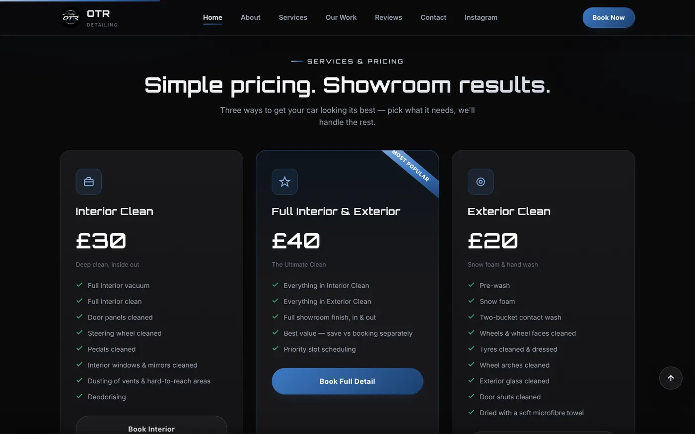
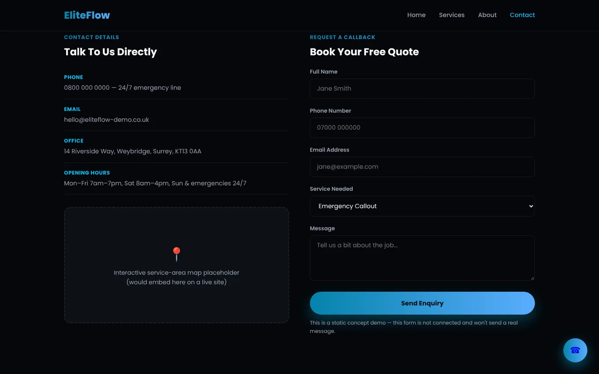

You're under a sink with both hands full and your phone starts buzzing on the bathroom floor. Unknown number. By the time you've dried your hands and rung back, it's 40 minutes later and the voice on the other end says "Oh, sorry, we've sorted someone else."

That's a missed call, and for a one-person business a missed call is very often a missed job. This post explains what an AI receptionist actually does when it picks up for you, what it can't do, what ours costs, and how to work out whether it's worth it for you (sometimes it isn't).

## Callers don't have to wait for you, the next number is one tap away

When someone calls a tradesperson, a barber or a detailer, they usually want something sorted soon. If you don't answer, the easiest thing for them to do isn't to leave a message and wait. It's to tap the next result on Google.

The trouble is that when you're on your own, you can't answer and work at the same time. You can't stop mid-fade, climb down a ladder or put down a pressure washer every time the phone goes. So the calls you miss are often during the hours you're busiest, which can be exactly when people are trying to book you.

## Make the calls you do get easier to handle first

Before you pay for anything, fix the cheap stuff. Some calls only happen because your website or profile didn't answer the question.

- **Put your prices on your website**, even as "from" prices. "How much is a full valet?" is a call you never need to take.
- **Show your hours and areas clearly**, on your site and your Google profile, so people aren't ringing to ask if you cover their postcode.
- **Add a callback form** next to your phone number, so someone who can't get through has a second way in that isn't voicemail.
- **Record a useful voicemail greeting**: say when you'll ring back and point people to the booking page.

. A big call button and a 24/7 promise. Lovely, until 2am, when someone actually has to pick up.")

That last point is the catch on lots of trade websites, including the concept sites we build to show what's possible. A "24/7" badge and a floating call button make it really easy to ring you. They don't make anyone answer.

## What an AI receptionist actually does on a call

An AI receptionist is a voice assistant that answers your phone, speaks to the caller in plain conversation and does the admin you'd normally do yourself between jobs. Here's how ours, YRB VoiceDesk, works on a typical call:

1. **You keep your number.** Calls are forwarded to the receptionist when you choose: when you're busy, after hours, or all the time.
2. **It says what it is.** It introduces itself as an AI receptionist and tells the caller the call is recorded.
3. **It answers questions in your words.** Prices, opening hours, areas covered, what to bring. It only uses answers you've agreed with us first.
4. **It books the job.** It checks your free slots and books straight into Google Calendar, Outlook or Apple Calendar.
5. **It passes urgent calls to you.** Anything urgent or sensitive goes to a real person straight away.
6. **It tells you what happened.** A short summary of each call lands in your inbox, and you can check the recording and transcript.

So instead of a list of missed calls at 6pm, you get a list of booked jobs and a few summaries to read over your tea.

## What it can't do (and shouldn't pretend to)

Being honest about the limits is the bit most adverts skip.

- **It isn't a plumber, a vet or a doctor.** It won't diagnose anything. It's set up to recognise urgent calls and hand them to you, or tell the caller to ring 999 where that's the right thing to do.
- **It doesn't plug into every booking app.** It books into Google, Outlook, Apple or another CalDAV calendar. If you run your diary in salon or practice software it can't connect to, it takes the caller's details and sends them to you to confirm.
- **It only knows what you tell it.** If your prices change and nobody updates it, it'll quote the old ones. When it isn't sure, it hands over rather than guessing.

## Do the maths before you sign anything

YRB VoiceDesk costs £299 a month plus a £500 one-off setup fee. If you take it alongside a new YRB Nova website, the setup fee is waived. Full details are on our [AI receptionist page](../voicedesk.html).

That's a real monthly cost, so work out whether it pays for itself. The sum is simple:

**missed calls a week × 4.33 weeks × how many would have booked × your average job value**

Here are two made-up examples, so you can see how differently it can come out:

- **A busy mobile mechanic** who misses 6 real enquiries a week, would have booked 1 in 3, and averages £150 a job: 6 × 4.33 × ⅓ × £150 is about £1,300 a month walking off to someone else. A receptionist would make sense.
- **A barber with a full book** who misses 1 call a week, would have booked 1 in 2, and charges £20 a cut: 1 × 4.33 × ½ × £20 is about £43 a month. Spending £299 to save that would be daft. A booking link in your bio does more.

Use your own numbers, not ours. If you don't know how many calls you miss, your phone's call log will tell you.

## A real example: answer the easy questions before anyone rings

:::case OTR Detailing | Mobile car valeting and detailing, Coventry
**The business:** Gideon runs OTR Detailing on his own and drives to customers' houses. When he's working, he's elbow-deep in someone's car, not sat by the phone.

**What we built:** a website that answers the questions people used to have to message him about. His three packages are on the page with prices (£20 exterior, £30 interior, £40 full) and exactly what each includes, along with where he works.

**Why it matters here:** OTR Detailing doesn't use an AI receptionist. We're including it because it's the step that comes first. If your website already answers "how much" and "do you cover me", the calls left over are the ones worth picking up. The site is new, so we have no figures on calls or bookings yet, and we won't invent any. The full story is in our [case study on OTR Detailing and Styled By KY](case-studies-otr-detailing-styled-by-ky.html).
:::

## Give people a second way in

Not every caller wants to talk, and some would rather fill in a form at 11pm than ring at all. A callback form next to your number catches those people even if nobody's on the phones.

An AI receptionist covers the phone. A good website covers everyone else. They work best together, because both end up in the same calendar.

## Do this today

1. **Check your call log for last week** and count the calls you missed or returned more than an hour later.
2. **Ring a few of them back** if you haven't, and ask whether they found someone else.
3. **Run the sum above** with your own numbers.
4. **Update your voicemail greeting** so it says when you'll call back and where to book.
5. **Put your prices and areas on your website** so fewer people need to ring at all.
6. **Add a callback form** next to your phone number if you don't have one.

If people mostly message rather than ring, our post on [why "DM for price" costs you customers](dm-for-price.html) covers the same problem in your inbox. If you'd like someone to look at the whole picture, get a [free website audit](../free-website-audit.html) and we'll tell you what we'd fix first.

## FAQ

### What is an AI receptionist?

It's a voice assistant that answers your business phone, talks to callers in normal conversation, answers common questions, books appointments into your calendar and passes urgent calls to a person.

### How much does an AI receptionist cost in the UK?

Prices vary between providers, so check what's included. Ours, YRB VoiceDesk, is £299 a month plus a £500 setup fee, and the setup fee is waived if you take it with a new YRB Nova website.

### Can I keep my own phone number with an AI receptionist?

Yes. You keep your number and forward calls to the receptionist when you choose, for example only when you're busy or after hours.

### Will customers know they're talking to an AI?

They should. Ours introduces itself as an AI receptionist and says the call is recorded at the start of every call, and anyone who'd rather speak to a person can ask.
