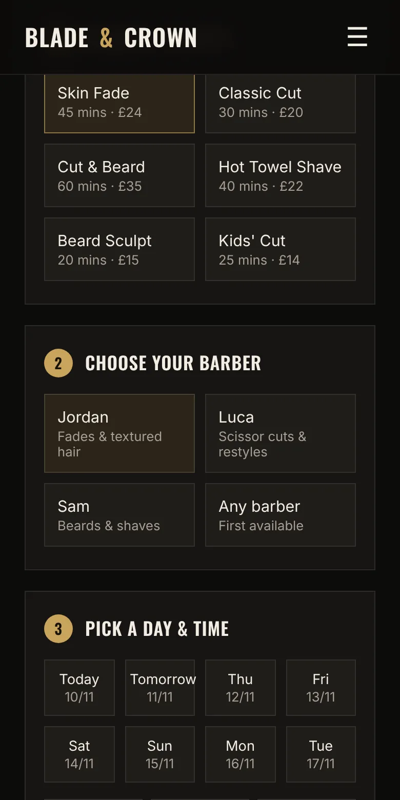
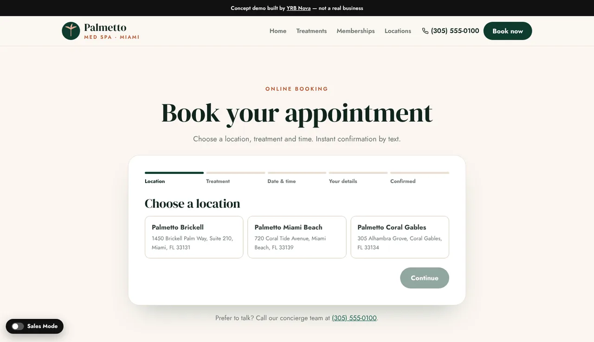
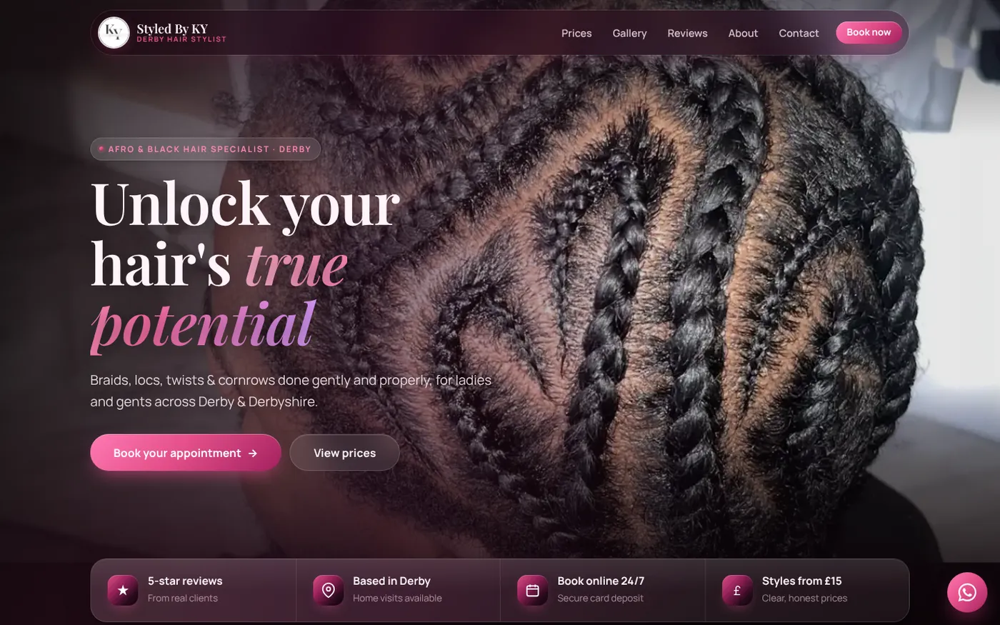

It's Saturday, you've got clippers in one hand and your phone buzzing in your pocket. Three people want "anything this afternoon?", one wants to move Tuesday to Wednesday, and one just sent a voice note. By the time you've replied to all of them, two have booked somewhere else.

That's the moment most barbers, stylists and valeters start wondering about online booking. Sometimes it's the right answer. Sometimes a clear price list and a phone number would do the job just as well. Here's how to tell the difference.

## The quick test: set menu or quote first

Online booking earns its keep when your work is a set menu of appointments with known lengths. A skin fade is 45 minutes. A set of medium knotless braids blocks out an afternoon. A booking system is basically your diary with the door left open, so customers can find a gap without asking you first.

You probably **do** need online booking if:

- most of your work is short, repeatable appointments
- you spend a real chunk of every day answering "are you free on...?"
- a lot of your enquiries come in the evening, when you're not replying
- no-shows and last-minute cancellations are costing you money

You probably **don't** need it (yet) if:

- every job needs a quote first, like a bathroom refit or a roof repair
- you only take a handful of big jobs a month
- you love the phone and your customers love calling you

For quote-led trades, a "from" price and a good enquiry form usually work better. We covered that in our post on [why "DM for price" costs you customers](dm-for-price.html).

## What a good booking flow looks like

A booking system is only useful if people actually finish it. The good ones feel like ordering a coffee: pick, pick, pick, done.

The cover image at the top of this post is the booking page on our Blade and Crown barber concept site. It's a demo we built to show what's possible, not a real shop. You choose a service, choose a barber, pick a day and time, then add your details. The summary on the right updates as you go, so you always know what you're booking and what it costs before you press the button.

The details that make it work:

- **The price and the length are on every option.** "Skin Fade, 45 mins, £24" answers two questions at once.
- **The rules sit next to the button.** On this concept it says pay in the shop after your cut, with free cancellation up to 2 hours before. No small print hunt.
- **"Any barber" is an option.** Plenty of customers don't care who cuts their hair, they care about getting in today.

## Show people how many steps there are

For anything longer than three or four choices, a progress bar stops people wondering how long this is going to take.

On our Palmetto Med Spa concept (again, a demo, not a real clinic), the steps are labelled across the top: location, treatment, date and time, your details, confirmed. It also keeps a phone number underneath for anyone who'd rather talk. A booking system shouldn't lock out the customers who like a chat.

## Deposits: the bit that actually stops no-shows

A booking system makes it easy to book, and just as easy to book and not turn up, because clicking a button costs nothing. Asking for a small card payment at the time of booking means the customer has something to lose if they ghost you, and you're not left with a dead hour and no money.

Whether you need one depends on your work:

- **Short, cheap appointments** (a quick trim, a beard tidy) often work fine with "pay on the day" and a clear cancellation rule, like the Blade and Crown concept.
- **Long appointments** (braids, locs, a full detail, colour work) are where a no-show really hurts, because you've turned other people away for that slot. A deposit makes a lot of sense here.

Be clear about the rules. Say how much the deposit is, whether it comes off the final price, and what happens if they cancel. Customers are fine with deposits. They're not fine with surprises.

## A real example: Styled By KY

:::case Styled By KY | Afro and black hair specialist, Derby
**Before:** booking with Deborah meant a long DM conversation. "What's the price for medium knotless?" "Do you have Saturday?" "How do I pay the deposit?" The same questions, all day, while she was trying to do hair.

**What we built:** a four-step online booking flow. Pick a style, pick a time, add your details, pay a deposit by card. It works on a phone in about two minutes, any time of day. Behind it sits a private dashboard where Deborah can see her bookings, calendar and payments, and handle refunds, without touching any code.

**Why:** her clients mostly find her on their phones, often late at night. Taking the deposit upfront means fewer no-shows and no chasing payments.

The site is recent, so we don't have months of booking data yet, and we won't make any up. The full story is in our [case study on OTR Detailing and Styled By KY](case-studies-otr-detailing-styled-by-ky.html).
:::

## Ready-made booking app or one built into your site

You've got two broad options.

**A ready-made booking app.** There are plenty of booking platforms built for salons, barbers and appointment businesses. They're quick to set up and you can link to them from your website and Instagram. The trade-off is that your booking page looks like theirs, not yours, and some show customers other local businesses too. Check the fees and the contract before you sign up, because they vary a lot.

**A booking flow built into your website.** This is what we did for Styled By KY. It matches your brand, sits on your own site, and asks exactly the questions your business needs (hair length, car size, home visit or not). It's a bigger build than a simple brochure site, because it has to be tested properly with real payments before it goes live.

Neither is wrong. A ready-made app linked from a clear website is a perfectly good first step. When it starts getting in your way, that's the time to look at a built-in flow.

## Do this today (before you buy anything)

1. **Count the booking messages.** For one week, tally every DM, text and call that's just someone trying to book or move an appointment.
2. **Write your menu with lengths.** Every service, how long it takes, and what it costs. You need this for any booking system, and it's useful on your website anyway.
3. **Decide your cancellation rule.** How much notice do you need, and what happens if someone doesn't turn up? Write it in one sentence.
4. **Decide if you want a deposit.** Start with your longest appointments.
5. **Put one clear "Book" button everywhere.** Instagram bio, Google Business Profile, website header. One link, the same place every time.

If that tally from step one comes back in double figures, online booking is probably worth a look.

Our [website packages and prices](../services.html) are on the page if you want to see what a new site costs, and if you run a barbershop there's more on what we build in our [websites for barbers](../websites-for-barbers.html) page.

## FAQ

### Do I need a booking system on my website?

Not always. If most of your work is short appointments with set prices, like hair, beauty, barbering or valeting, online booking usually saves you a lot of back-and-forth. If every job needs a quote first, a clear price guide and an enquiry form are often enough.

### Should I take a deposit for online bookings?

For long or expensive appointments, a deposit is the simplest way to cut no-shows, because the customer has something to lose if they don't turn up. Say clearly how much it is, whether it comes off the final price, and what happens if they cancel.

### Can I add online booking to my existing website?

Usually, yes. The quickest way is to link a "Book" button to a ready-made booking app. A booking flow built into the site itself takes longer, because it needs testing with real payments, but it matches your brand and asks the questions your business needs.

### Is online booking better than taking bookings by DM?

For appointment businesses, it usually is. Customers can book at any hour without waiting for a reply, and you stop spending your breaks answering "are you free Saturday?". Keep a phone number on the page too, for the customers who'd rather talk.
