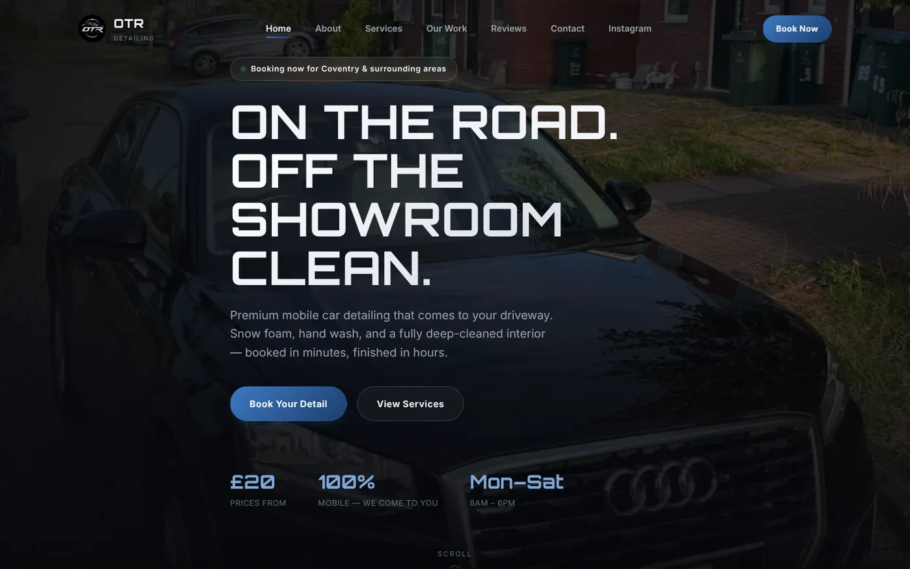
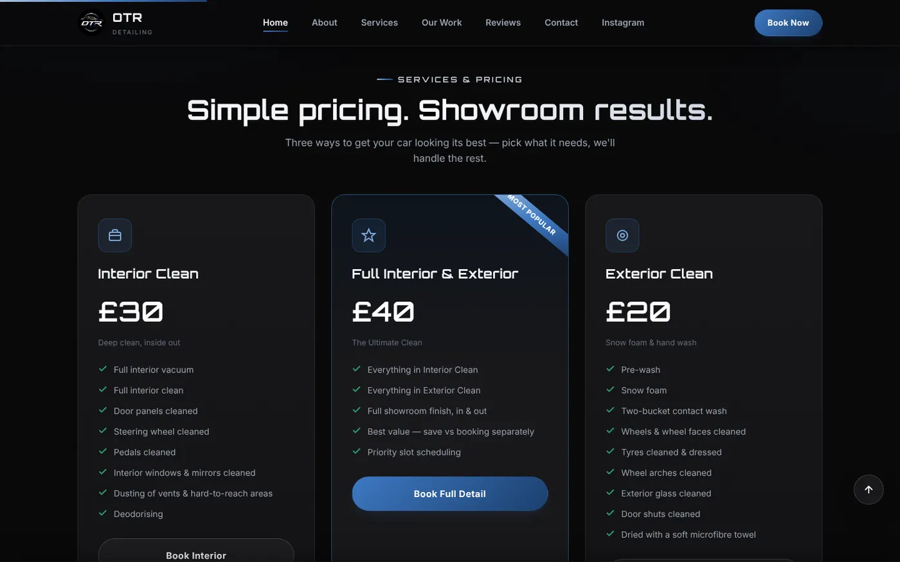
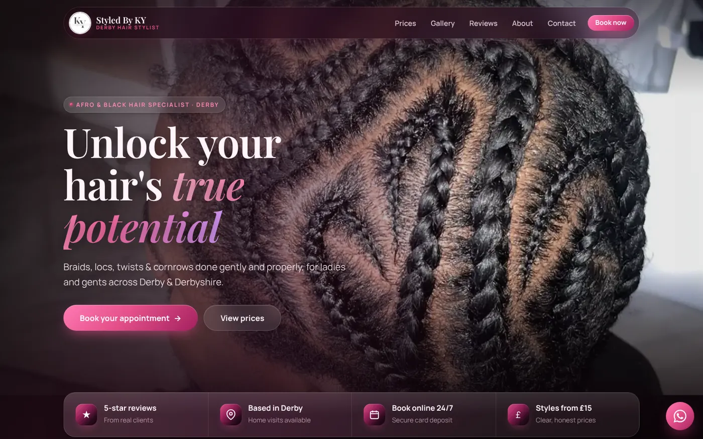
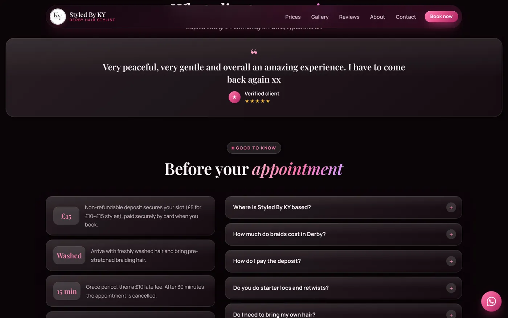
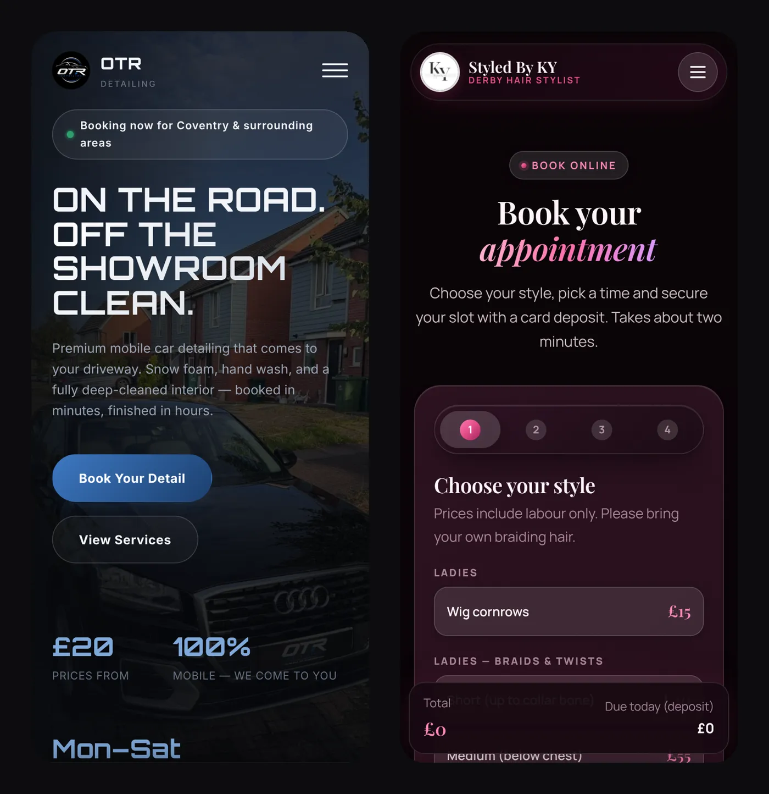

Lots of great small businesses run entirely on Instagram. The work is brilliant, the photos are brilliant, and then a new customer asks "how much?" and waits three hours for a reply while you're elbow-deep in a wheel arch or halfway through a set of knotless braids.

By then they've messaged someone else.

These are two businesses we built for this year. Both are run by one person, both had great work to show, and both were losing customers to the same thing: **nowhere to send people except their DMs.**

A quick note before we start. These are real clients, but they're recent, so we don't have six months of data yet. We're not going to invent a "312% increase in bookings" to make this look better. You'll get what we built, why we built it that way, and what any small business can steal from it.

:::case OTR Detailing | Mobile car valeting and detailing, Coventry
**The business:** Gideon runs OTR Detailing on his own. He drives to your house and makes your car look like it's just left the showroom, Monday to Saturday, around Coventry.

**The problem:** All his best work lived on Instagram. If you wanted to know the price, what "full detail" actually included, or whether he covers your area, you had to message him and wait.

**What we built:**

- A homepage that tells you what he does, where he works and his starting price in about four seconds.
- A clear price list with three options (£20 exterior, £30 interior, £40 full), each with exactly what's included. No "prices on request", no mystery.
- A "Recent work" gallery built from his own photos of real customers' cars, not stock photos of a Lamborghini he's never touched.
- A reviews page, plus a private booking manager where Gideon can track bookings and customers, and approve genuine reviews (including the less glowing ones) before they show on the site.

**Why it's built like that:** most people looking for a valet want three answers: how much, do you come to me, and are you any good. The homepage answers all three before you scroll. The prices are on the site because "DM for price" is where most customers quietly give up.

:::

:::case Styled By KY | Afro and black hair specialist, Derby
**The business:** Deborah is the stylist behind Styled By KY. She does braids, locs, twists and cornrows across Derby, with home visits available.

**The problem:** Booking a hair appointment by DM is a full-time job in itself. "What's the price for medium knotless?" "Do you have Saturday?" "How do I pay the deposit?" The same questions, all day, while she's trying to actually do hair.

**What we built:**

- A full price list for ladies, gents and locs, broken down by length, so clients can work out the price before they ask.
- A four-step online booking flow: pick a style, pick a time, add your details, pay a deposit by card. It works on a phone in about two minutes, any time of day.
- A private dashboard where Deborah can see her bookings, calendar and payments, and handle refunds, without touching any code.
- Reviews copied straight from her Instagram DMs, typos and all. Real messages from real clients beat a polished testimonial every time.

**Why it's built like that:** her clients mostly find her on their phones, often late at night. So the whole booking flow was designed for a phone first, and the deposit is paid upfront, so fewer people no-show and she isn't chasing payments.

:::

## What both sites have in common

They look completely different (one is all black and chrome, the other is pink and glossy), but they follow the same rules:

1. **The price is on the page.** Hiding prices doesn't make you look premium. It makes people leave.
2. **Their own photos, not stock.** Their work is the selling point. A stock photo of a smiling model tells a customer nothing.
3. **One clear next step.** Every page ends with "book" in some form. Nobody has to guess what to do next.
4. **Built for phones first.** If it doesn't work one-handed on a bus, it doesn't work.
5. **Less admin for the owner.** Booking managers, deposits and FAQs take the boring messages off their plate, so they can get on with the actual work.

## What you can steal for your business today

You don't need a new website to start on this. Today, you could:

- Put your prices in your Instagram bio or highlights. Even "from £20" filters out time-wasters.
- Write down the five questions you get asked most, and answer them in one pinned post or highlight.
- Take a photo of every job you finish. That's your future portfolio, and it's free.

When the DMs start eating your day, that's the sign you need a proper site.

## FAQ

### How long did these websites take to build?

Our Basic sites go live in about 2 days and bigger builds take up to 5. Booking systems and dashboards like the ones above take longer, because they need testing with real payments.

### Do I need a booking system on my website?

Not always. If most of your work comes through quotes, a clear price guide and a contact form might be enough. If you take lots of short appointments, like hair, beauty or valeting, online booking with a deposit usually saves you hours a week.

### Can you use photos from my Instagram?

Yes. Both of these sites were built using the owners' own Instagram photos and videos. Real photos of your work almost always beat stock images.
