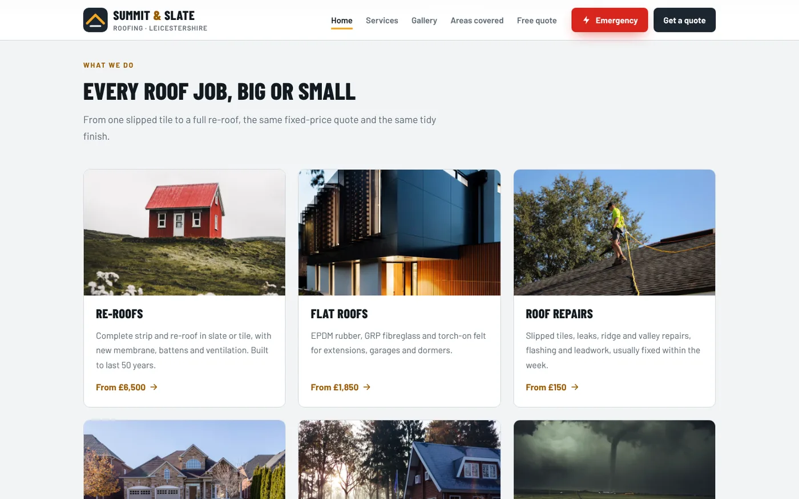
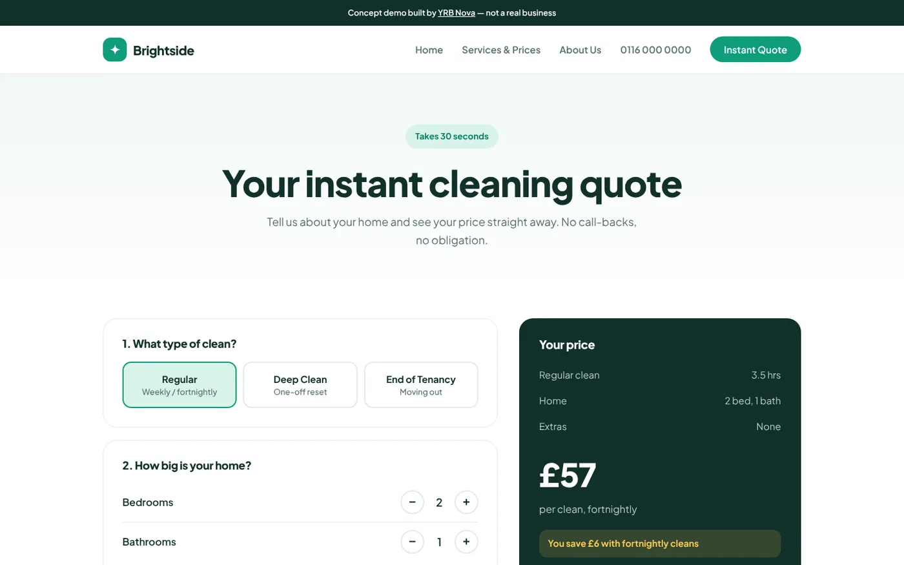
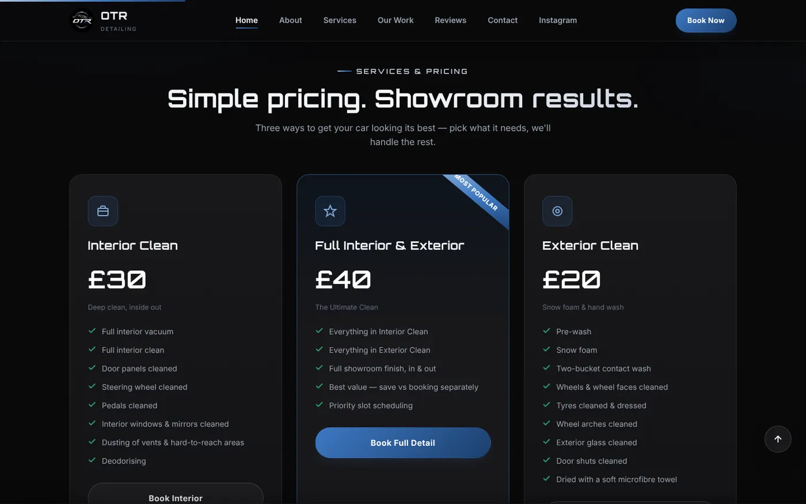

It's 10:40pm. Someone on the sofa wants their car valeted before a wedding on Saturday. They find two local businesses. One says "DM for price". The other says "Full valet £40" with a Book button underneath.

You already know which one gets the job. The first business finds the DM at 7am, replies "hiya, what car is it?", and hears nothing back. The customer isn't being rude. They booked someone else while you were asleep.

## What a customer hears when you say "DM for price"

You probably mean "every job is a bit different and I don't want to give a wrong number". Fair enough.

What the customer often hears is one of these:

- "It's expensive, and I'll tell you once you're hooked."
- "The price depends on how much money I think you've got."
- "Get ready for a back-and-forth conversation you didn't want."

None of that is true, but you don't get the chance to explain. Nobody tells you they didn't message. They just quietly go to the next tab.

There's also a time cost on your side. Every "how much?" DM is a little admin job. If you answer twenty a week and half the people vanish after you reply, that's hours you could have spent on paid work (or on your tea while it's still hot).

## The worry behind hiding prices, and why it usually doesn't hold

There are three common worries behind keeping prices off a website.

**"Competitors will undercut me."** They can already find your price by asking. Anyone determined to undercut you will. Meanwhile, every real customer has to jump through a hoop your competitor doesn't make them jump through.

**"Every job is different."** Usually true for the final figure. Rarely true for the starting point. A roofer can't price a re-roof from a phone call, but they know roughly what the smallest one costs.

**"People will think I'm too expensive."** Some will, and that's useful. A customer who leaves after seeing £40 was never going to book at £40. Better they leave on the website than after ten minutes of your time in the DMs.

## Three ways to show your prices (pick the one that fits your work)

You don't need one rigid price list for everything. Here are three approaches, each shown on one of our concept sites. These are demo sites we built to show what's possible, not real businesses.

### 1. A fixed price list, for work that's the same every time

If a skin fade is a skin fade, just say what it costs. Barbers, valeters, nail techs, dog groomers and anyone else with a set menu should be doing this already.

The cover image at the top of this post is the price list on our Blade and Crown barber concept. It lists every cut, beard and combo with a one-line description and a price on the right. A Buzz Cut is £14. A Cut and Beard is £35. No guessing.

The one-line description does a lot of work. "Blended down to the skin, finished with a line-up" answers the follow-up question before it's asked.

### 2. "From" prices, for work that varies

This is the answer for tradespeople whose jobs really do differ: roofers, builders, electricians, plumbers. Give the starting point and say what changes the price.

A "from" price does two jobs. It reassures the person with a small job that you'll take it on, and it warns the person expecting a £500 re-roof before they waste your evening. Then the "Get a quote" button handles the detail.

Be honest with it. If nobody has ever actually paid your "from" price, it's not a starting price, it's bait, and customers can smell it.

### 3. An instant quote calculator, for work that follows a formula

Some businesses price by a formula even if it feels custom: cleaners (bedrooms, bathrooms, how often), window cleaners, gardeners, removals. If you can work out a price from a few answers, a website can do it too.

On our Brightside Cleaning concept, you pick the type of clean, the number of bedrooms and bathrooms, how often, and any extras like an oven clean. The price updates as you go. The customer gets an answer in half a minute at any hour, and you get an enquiry from someone who has already seen the number and is still keen.

## A real example: OTR Detailing

:::case OTR Detailing | Mobile car valeting, Coventry
**Before:** Gideon's best work lived on Instagram. If you wanted to know the price or what a "full detail" included, you had to message him and wait for a reply.

**What we built:** a price list with three packages right on the site: £20 exterior, £30 interior and £40 full. Each one spells out exactly what's included, so a customer can choose and book without sending a single message.

**Why:** most people looking for a valet want three answers: how much, do you come to me, and are you any good. Putting the prices on the page answers the first one instantly.

The site is recent, so we don't have months of booking data to show you yet, and we won't invent any. You can read the full story in our [case study on OTR Detailing and Styled By KY](case-studies-otr-detailing-styled-by-ky.html).
:::

## Do this today (no new website needed)

You can start fixing this before lunch:

1. **Write down your five most-asked prices.** The ones you type out in DMs every week.
2. **Pick your approach for each:** fixed, "from", or "depends on these two things".
3. **Put them where people look first.** Your Instagram bio, a pinned post or highlight, your Google Business Profile services list, and your website if you have one.
4. **Say what's included.** "Full valet £40, inside and out, about 2 hours" beats "Full valet £40" every time.
5. **Add one line on what changes the price.** For example, "Larger cars and heavy pet hair may cost more. We'll always tell you before we start."
6. **Swap "DM for price" for a clear next step.** "Book online", "Get an instant quote" or "Send a photo for a fixed quote" all work.

For what it's worth, we follow our own advice. Our [website packages and prices](../services.html) are on the page for anyone to see, from £350 for a one-page site.

## When "contact us" is still the right call

There are a few cases where a fixed number genuinely does more harm than good. Big one-off building projects, emergency call-outs where the job is unknown until you're on site, and anything where materials prices swing week to week.

Even then, you can still give people something: a typical range from recent jobs, what affects the price, and how fast you'll come back with a written quote. "Fixed written quote within 48 hours, with photos" is far more reassuring than "contact us for pricing".

If you're not sure whether your site is losing people at this step, it's one of the [signs your website is costing you customers](signs-website-losing-customers.html), and it's something we check in every [free website audit](../free-website-audit.html).

## FAQ

### Should I put prices on my small business website?

In most cases, yes. If your work has a fixed price, list it. If it varies, show a "from" price and explain what changes it, so customers know if you're in their budget before they get in touch.

### What should I say instead of "DM for price"?

Give a number and a next step, such as "Full valet £40, book online" or "Repairs from £150, send a photo for a fixed quote". The aim is that nobody has to message you just to find out whether they can afford you.

### Will showing prices let competitors undercut me?

Your competitors can already find out your prices by asking. Hiding them mainly makes life harder for genuine customers, and a clear price with a clear description of what's included is hard to undercut on value.

### How do I price jobs that are all different?

Use "from" prices for each type of job and list the things that change the final figure, like size, access or materials. If your pricing follows a formula, an instant quote calculator on your website can do the maths for the customer.
