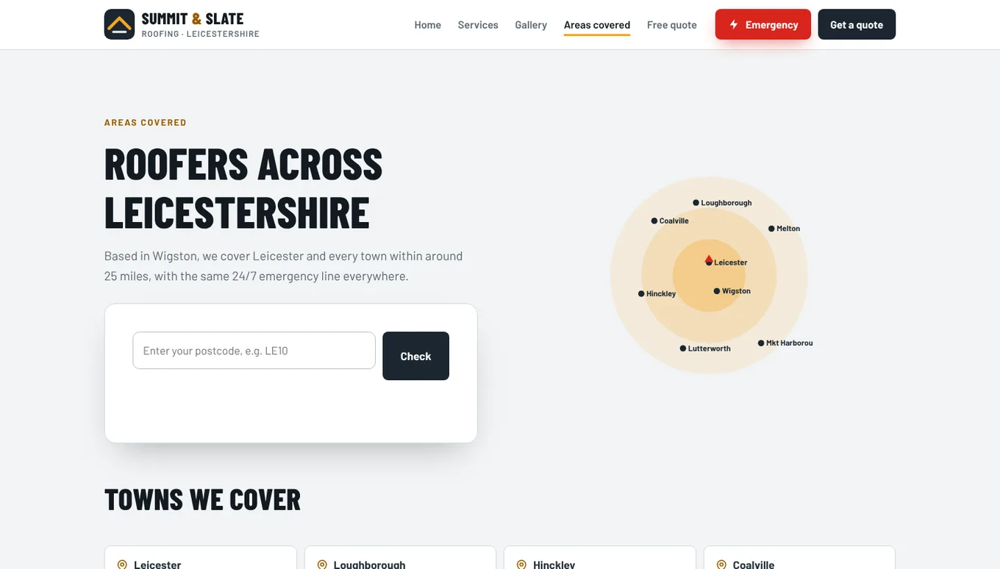

A customer's boiler packs up on a Sunday. They type "plumber near me" into Google, and before any website appears they get a map with three pins on it. They ring one of the three.

If you're not one of those pins, you didn't lose the job. You were never in the running.

Those pins come from Google Business Profiles. Getting one is free, takes an evening, and is the single most useful bit of admin a local business can do. Here's how to set it up properly, step by step.

## Your Google Business Profile is the pin on the map

A Google Business Profile is the box that shows your name, phone number, opening hours, photos and reviews when someone searches for you or for what you do nearby. It's what appears on Google Maps, and in that map pack at the top of a local search.

It's not the same as your website. It's more like a shop sign Google holds up for you. A good one sends people straight to your phone, your website, or your door.

Google says there's no way to pay for a better local ranking. That's annoying if you had a budget set aside, and great news if you didn't.

## Check you're not already on there

Before you create anything, search Google Maps for your business name and town. There may already be a listing for you, for example if a customer once added you to Maps.

- **If you find one that nobody manages:** select it, then choose "Claim this business" and "Manage now". On the Maps app, it's under the About tab.
- **If someone else has already verified it** (an old business partner, a former web designer, your cousin who "sorted the internet"), you'll need to request ownership from them rather than claiming it.
- **If nothing comes up:** go to business.google.com/add and choose "Add your business to Google".

Making a second listing for a business that already has one only confuses Google, and it'll confuse your customers too.

## Fill in the basics exactly as they are in real life

Google asks for your details one screen at a time. These are the ones that trip people up.

**Your business name.** Use your real-world name, the one on your van, sign or invoices. Google's guidelines don't allow extra info in the name, so "Dave's Plumbing" is fine and "Dave's Plumbing Cheap Emergency Plumber Leicester 24/7" is asking to be suspended.

**Your category.** Pick the one that describes your main work as closely as possible. You can add more later, but the main one matters most.

**Your address.** It has to be somewhere you really operate. Google doesn't accept PO boxes, and a virtual office you just rent for post doesn't qualify either.

**Your phone number.** It should ring your business and be under your control. Premium-rate numbers aren't allowed at all.

**Your website.** If you have one, add it. If you don't, the profile still works on its own, and our post on [website vs Instagram](website-vs-instagram.html) covers when you actually need both.

The cover of this post is the Nottingham page from our Brightwell Dental concept site (a demo we built, not a real practice). Every location page shows the same four things a Google profile does: name, address, phone and today's hours. When your website and your profile say the same thing, customers don't have to wonder which one is out of date.

## If you go to the customer, hide your address

Plumbers, electricians, cleaners, mobile valeters and dog groomers with a van are what Google calls service-area businesses. You work at the customer's place, so you don't want strangers turning up at your house expecting a boiler service.

Google's own guidance is that service-area businesses should hide their address from customers. You still give it to Google (it needs to know where you're based), but it won't show on your profile.

Then add your service areas. The current rules:

- You can list **up to 20 service areas**, such as towns, cities or postcode areas.
- The whole area shouldn't stretch more than **about two hours' driving** from where you're based.

So a roofer in Wigston can list Leicester, Hinckley and Loughborough. Listing Leicester, Glasgow and Truro because "we'd go if the money was right" isn't how it works.

On our Summit and Slate Roofing concept site, the Areas covered page lists the same kind of towns you'd put in a Google profile, plus a postcode box. Same towns in both places, no mixed messages.

## Get verified (the bit that takes the longest)

Before your profile goes fully live, Google wants proof that you're real and that you run the business. It will offer you one or more ways to verify, and which ones you get depends on your business. You don't get to pick from a menu.

One of the options Google may offer is a **video recording**. From Google's own help pages:

- Record it on your phone, through your Business Profile, in one go. It has to be live, unedited and at least 30 seconds long.
- Show where you are (street signs, your building number, or nearby landmarks if you work from home).
- Show the business exists: your signage, or for a trade, your tools, equipment, branded van or business cards.
- Show you're in charge: you doing the work, opening up the van, or a business document that matches your profile name.
- Keep bank details, ID numbers and other people's faces out of the shot.

Google says review can take up to five business days. If the video gets rejected, it tells you why and you can record a new one. Plan it like a tiny film: script the route in your head, wipe the van down, and maybe don't do it at 7am in your dressing gown.

## Fill in everything else, then keep it current

Once you're verified, most people stop. That's a mistake, because Google says businesses with complete and accurate info are more likely to show up in local results.

Google ranks local listings on three things: **relevance** (how well your profile matches the search), **distance** (how close you are to the searcher) and **prominence** (how well known you are, which includes your reviews and rating). You can't move your house closer to customers, but you can do plenty about the other two.

That's the contact section on our Elite Electric concept site. Phone, email, address and opening hours, all written plainly. Whatever hours are on your website should be the same hours on your Google profile, including bank holidays and the week you shut for Christmas.

## Do this today: your 30-minute Google profile checklist

1. Search Google Maps for your business name and town, and claim the listing if it's there.
2. Check your name matches your sign or van, with no extra keywords.
3. Pick the most accurate main category.
4. Hide your address if you go to customers, and add your towns.
5. Add your opening hours, including any special hours coming up.
6. Upload photos of your real work, your van or your premises. Our guide to [taking photos of your work on a phone](how-to-take-photos-of-your-work.html) helps here.
7. List your main services, with a starting price if you can.
8. Reply to every review you already have, good or bad. Google says replying shows customers you value their feedback.
9. Put the same name, phone number and hours on your website.

If you've done all that and want a second pair of eyes, our [free website audit](../free-website-audit.html) checks your site against what customers see on Google. If you're in our patch, our [web design in Leicester](../web-design-leicester.html) page shows how we build sites for local businesses.

## FAQ

### Is a Google Business Profile free?

Yes. Adding or claiming your profile costs nothing, and Google says there's no way to pay for a better local ranking. Be wary of anyone who rings up offering to "guarantee" you the top spot.

### Can I get on Google Maps without a shop or office?

Yes. If you visit customers rather than having them come to you, set yourself up as a service-area business, hide your address and list the towns you cover (up to 20, within about two hours' drive).

### How long does Google Business Profile verification take?

It depends on the method Google offers you. For video verification, Google says review can take up to five business days, and if it's rejected you can record and submit a new one.

### Can I use my home address for my Google Business Profile?

You can give Google your home address if that's where the business is run from. If customers don't visit you there, hide it so it doesn't appear publicly. PO boxes and virtual offices aren't accepted.
