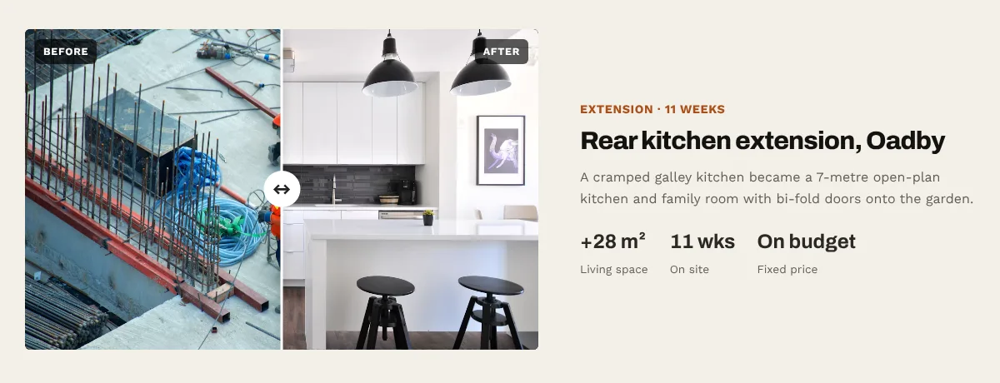
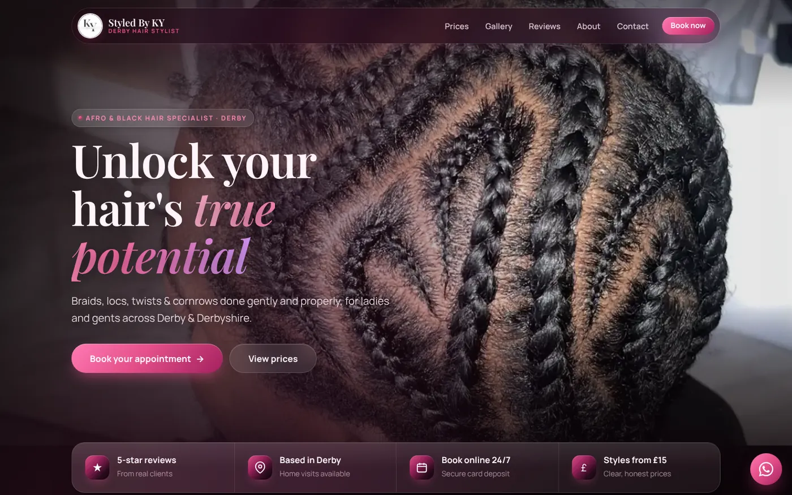
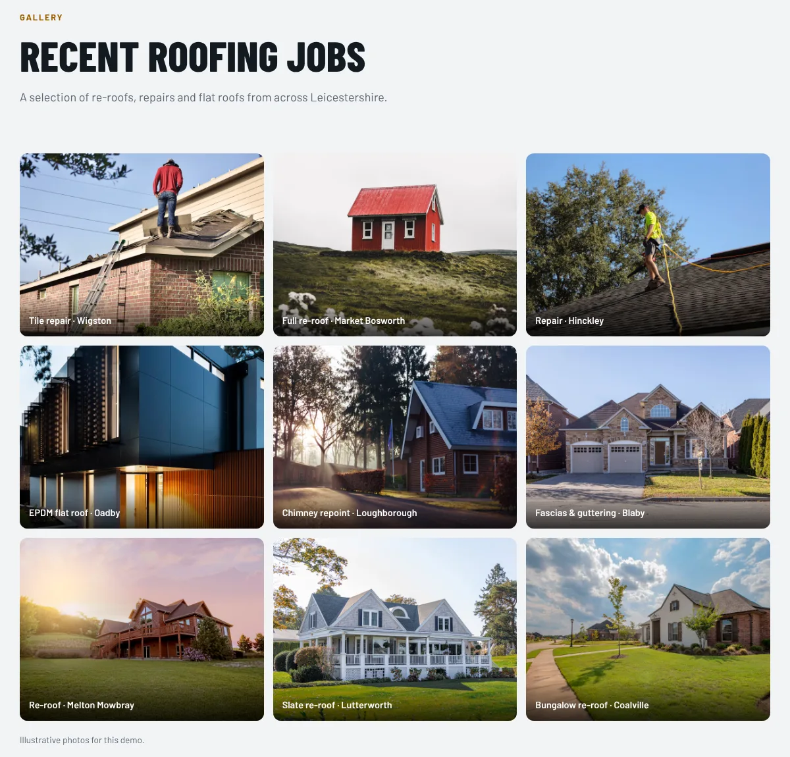

You've just finished a job you're proud of. The car is gleaming, the braids are perfect, the new bathroom tiles are dead straight. You grab your phone, take one quick photo in bad light with a wheelie bin in the corner, and drive off to the next one.

That photo is now your sales team. It has to convince a stranger, on their phone, that you're worth calling. Most of the time it isn't up to the job, and the fix costs nothing but about two extra minutes per job.

## Your photos are already doing the selling

When someone finds you, the first thing they check is your work. Not your logo. The work.

A stock photo of a smiling model tells them nothing about you. Your own photo of a real job, in a real street, tells them exactly what they'll get. The cover image on this post is a good example. It's the homepage we built for **OTR Detailing**, a mobile valeter in Coventry, and the car behind the headline is one of Gideon's own photos. A real car on a real street. Nobody looking at that thinks "stock photo". They think "he'll come to my driveway and do that".

## Light is the whole game

You don't need a better phone. You need better light. The usual culprit behind a disappointing work photo is that it was taken in the gloom, or straight into the sun.

- **Shoot in daylight when you can.** Bright cloud is your best friend. It's soft, it's even, and the UK has loads of it.
- **Put the light behind you,** not behind the job, or your work turns into a silhouette.
- **Indoors, open the blinds and turn the big light on.** Turn off warm lamps so the room isn't half orange, half blue.
- **Turn off the flash.** It flattens everything and puts a glare spot right where you don't want it, especially on paintwork, tiles and glossy hair.

For car detailers, a shady spot with open sky above shows off paint far better than direct midday sun, which bounces straight back into the lens.

## Clear the frame before you press the button

Ten seconds of tidying makes more difference than any editing app.

Move the bucket, the toolbox and the empty energy drink can. Check the edges of the screen for bins and your own thumb. For stylists, a plain wall beats a busy salon floor every time.

And please, wipe the lens. Your phone lives in a pocket with sawdust and crumbs, and a smeary lens makes everything look foggy. One swipe on your T-shirt fixes it.

## Before and after: same spot, same angle

Before and after shots are the most persuasive thing a tradesperson can post, because they show the change, not just the finish. The trick is making them match.

- **Stand in the same place for both.** Pick a marker, like a door frame or a drain cover, and line yourself up with it.
- **Hold the phone at the same height.** Chest height is easy to repeat.
- **Same orientation both times.** If the before is landscape, the after is landscape.
- **Take the before photo first, every time.** Once you've started, it's too late, and "I forgot the before" is the most common reason these never get posted.

On our Corbel Build Co. concept site (a demo we built, not a real company), each project has a slider you drag to compare before and after. The layout only works if the two photos line up, which is why the "same spot" rule matters.

## Get close, then get wide

One photo per job is a missed chance. Take a little set instead:

1. **The wide shot.** The whole car, the whole room, the whole head of hair. This is your "after".
2. **The detail.** Clean wheel spokes, a tidy grout line, the neat parting at the root. This is what shows you're careful.
3. **The context.** The van on the drive, the street, the finished room with the light on. This shows you're local and real.

Take each in portrait (for Instagram) and landscape (for your website). It takes seconds, and saves you later when a page needs a wide picture and you've only got tall ones.

## A real example: Styled By KY

:::case Styled By KY | Afro and black hair specialist, Derby
**The photos:** Deborah's work is braids, locs, twists and cornrows, and her best advert has always been her own pictures of her clients' hair. When we built her site, we used her photos and videos rather than stock images.

**Where they went:** her own braiding work is the first thing you see on the homepage, with prices and booking one tap away. Like the look, check the price, book. No DMs needed.

**Why it works:** hair clients want to know "can she do *my* style, and will it look like that?". A real photo of a real client answers that better than any headline we could write.

We don't have months of data on this site yet, so we won't pretend we do. The full story is in our [case study on OTR Detailing and Styled By KY](case-studies-otr-detailing-styled-by-ky.html).
:::

## Things that make photos look worse, not better

- **Heavy filters.** If the colour doesn't match real life, the customer notices on the day. Keep it natural.
- **Zooming in with your fingers.** Walk closer instead. Pinching past your phone's proper zoom settings just crops the picture and makes it grainy.
- **Number plates, house numbers and faces you haven't asked about.** Blur the plate, crop the house number, and ask before you post someone's face. A quick "mind if I use this on my website?" is all it takes, and most happy customers say yes.

## Caption every photo with the job and the town

A photo with no words leaves the customer guessing. A short caption like "Full valet, Coventry" or "Slate re-roof, Lutterworth" tells them what it is and that you work near them.

That's the format on our Summit and Slate Roofing concept site (a demo, not a real roofer): every gallery photo has the job and the town on it. Search engines can't see a photo the way a person can, so the words around it, and the image's alt text, help them understand what it shows. Name your photo files the same way, like "full-valet-coventry.jpg" rather than "IMG_4471.jpg".

## Do this today

1. **Wipe your lens.** Right now. We'll wait.
2. **Make an album on your phone called "Website".** Every good job goes in there, so you're not scrolling through 4,000 photos of receipts later.
3. **Take a before photo on your next job,** from a spot you can find again.
4. **Shoot a set of three** when you finish: wide, detail, context.
5. **Write one line for each photo:** what the job was and which town.
6. **Ask your next happy customer** if you can use the photos. Then do it.

Do that for a month and you'll have a proper portfolio, for free. If you're weighing up where those photos should live, our post on [website vs Instagram](website-vs-instagram.html) covers what each one is good for.

When you're ready to give them a proper home, our [website packages and prices](../services.html) are all on the page, or you can start with a [free website audit](../free-website-audit.html) and we'll tell you honestly how your current photos come across.

## FAQ

### Do I need a professional photographer for my business website?

Not usually. For tradespeople, stylists and detailers, clear phone photos of your own real work tend to be more convincing than polished shots, because customers want to see what you actually do. Good light and a tidy frame matter far more than the camera.

### How do I take good before and after photos?

Take the before photo first, from a spot you can find again, then take the after from exactly the same place, height and angle. Use the same orientation for both and shoot in similar light so the only thing that's changed is your work.

### Can I use photos of customers' homes, cars or hair on my website?

Ask first. Most happy customers are glad to say yes, and asking avoids awkward conversations later. Blur number plates, crop out house numbers, and get clear permission before posting anyone's face.

### Should I use stock photos on my small business website?

Use your own photos for your work wherever you can. Stock images can fill a gap while you build up your own, but they can't show a customer what you'll do for them, and people can usually tell.
