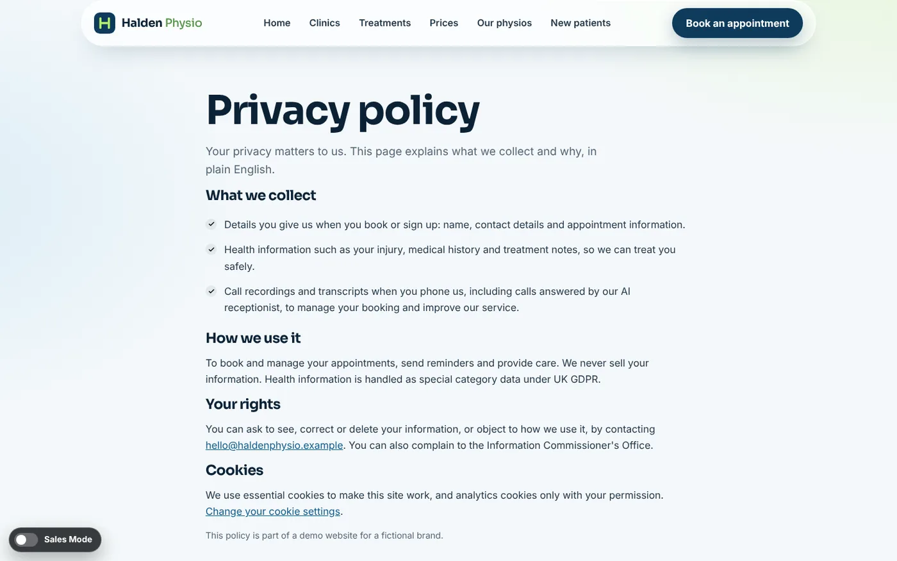
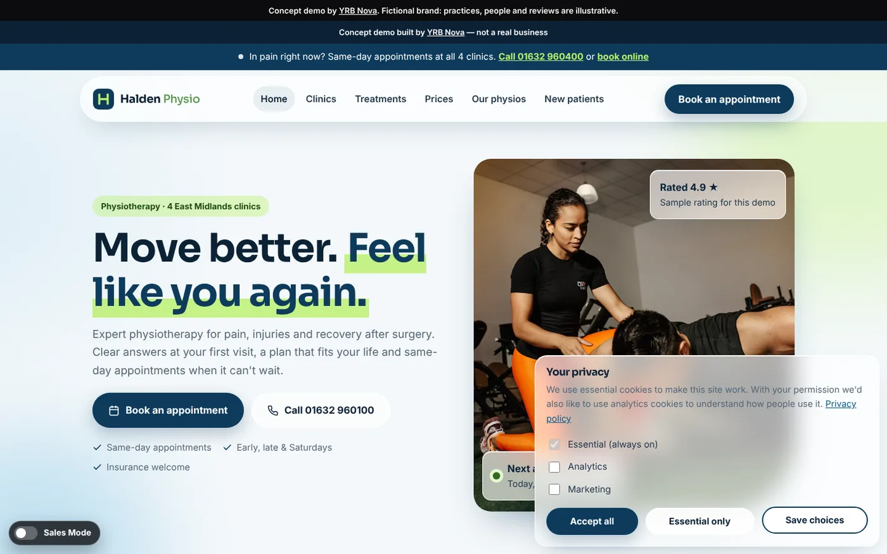

You add a contact form to your website on a Sunday night. By Monday you've read three articles about GDPR, installed a cookie plugin with 40 toggles, and you still don't know if you're breaking the law.

Good news: for most small businesses it's simpler than the internet makes it look. Here's what a UK small business website actually needs, in plain English.

A quick, serious note first. We build websites, we're not solicitors. Everything below is based on guidance from the Information Commissioner's Office (ICO), and we've linked to it so you can check. If your business handles anything sensitive, such as health records, get proper advice.

## The short answer

**Privacy policy:** if your website collects any personal information at all, you need one. A contact form, a booking system, a newsletter sign-up or a quote request all count. Even a "call me back" box asking for a name and phone number.

**Cookie banner:** it depends on what your site loads. If you only use cookies the site needs to work, you may not need a banner at all. If you run Facebook ads, Google Ads or anything that tracks people for advertising, you need one, and it has to be a fair one.

## Why a contact form means you need a privacy policy

Under UK GDPR, people have a right to know what you do with their information. The ICO's own advice for small businesses is that you have to know, and explain to others in a privacy notice, why you have that information.

That's all a privacy policy is. It doesn't need to be ten pages of legalese copied from a bank. It needs to answer a handful of plain questions:

- **Who you are** and how to contact you.
- **What you collect.** Name, phone number, email, address, job details, photos people send you.
- **Why you collect it.** To quote, to book the job, to send a reminder.
- **Who else sees it.** Your booking system, your payment provider, your email service, your accountant.
- **How long you keep it.**
- **What rights people have** (to see, correct or delete their information) and that they can complain to the ICO.

If you take bookings and payments online, like the four-step booking and deposit flow we built for Styled By KY, your privacy page needs to cover that too. Names, phone numbers and payments all pass through a booking flow, so say so.

Here's how short and readable this can be. Halden Physio is a **concept site** we built to show what a multi-clinic physio website could look like. It isn't a real business, but the privacy page is a decent model.

A physio clinic holds health information, which UK GDPR treats as special category data, so a real clinic would need more detail than this. A plumber with a contact form needs a lot less.

Don't want to write it from scratch? The ICO has a free [create your own privacy notice](https://ico.org.uk/for-organisations/advice-for-small-organisations/privacy-notices-and-cookies/create-your-own-privacy-notice/) tool for small organisations. Answer the questions, then edit the result so it matches what your website really does.

## The cookie rules changed in 2026

Cookie rules come from a separate law called PECR. The Data (Use and Access) Act 2025 changed them, and those changes came into force on 5 February 2026.

The big one for small businesses: you no longer need consent for cookies used **only** to count visits and see how your site is used, as long as you tell people clearly and give them a simple, free way to opt out. Cookies that remember someone's own display choices (like dark mode or text size) get the same treatment.

There are strings attached, and they matter:

- **The stats must be about how your site is used, not who is using it.** The ICO says this exception isn't for identifying, tracking or monitoring people.
- **If you use an outside analytics company, it has to work for you.** The ICO says the provider must act as your processor. If it uses the data for its own purposes, like linking visits to adverts, you need consent for that.
- **Advertising still needs consent.** Measuring how your ads perform is specifically not covered.

The fines went up at the same time. The maximum for breaking the cookie and marketing rules rose from £500,000 to £17.5 million or 4% of global turnover. Nobody's fining a window cleaner £17.5 million, but it shows the ICO means it.

The exact wording is in the ICO's guidance on [what the exceptions are](https://ico.org.uk/for-organisations/direct-marketing-and-privacy-and-electronic-communications/guidance-on-the-use-of-storage-and-access-technologies/what-are-the-exceptions/).

## What on your site actually needs permission

**Usually fine without asking:**

- Cookies the site needs to work, like a shopping basket, a login, or remembering someone's cookie choice.
- Cookie-free visitor stats.
- Simple usage stats under the new exception, as long as you explain them and offer an opt-out.

**Needs a yes first:**

- Advertising pixels from Meta, TikTok or Google Ads.
- Anything that tracks people across other websites.
- Embedded extras that set their own cookies. Maps, videos and booking widgets often do.

That last group catches people out. You didn't add a tracker, you added a map. But the map came with friends.

Here's how we handle it on our own website.

"Accept all" and "Reject all" are the same size and colour, because saying no shouldn't be a puzzle.

## What a fair cookie banner looks like

If you do need a banner, the ICO's guidance points to some clear rules of fair play:

- **Saying no is as easy as saying yes.** Same size buttons, on the first screen. No hiding "reject" behind three clicks.
- **Nothing optional is ticked in advance.**
- **Nothing optional loads before someone chooses.** A banner that asks permission after the Facebook pixel has already fired is decoration.
- **Choices are split by purpose,** so people can say yes to one thing and no to another.
- **People can change their mind later,** usually with a "Cookie settings" link in the footer.

Our Halden Physio concept shows the "Manage" view working like that.

Halden asks permission for analytics too. Under the 2026 rules that's no longer always required, but asking is the cautious option and it's never wrong. If you're not sure whether your stats tool qualifies for the exception, keep asking.

One more thing: a banner can't fix a site that's loading things it shouldn't. Plenty of sites have a lovely banner on top and a tracking pixel firing underneath regardless. Check what loads, not just what the banner says.

## Do this today

1. **List every way your site collects information.** Contact form, booking, quote request, newsletter, live chat.
2. **List every outside service those forms send it to.** Booking system, payment provider, email platform.
3. **Check your footer.** Is there a privacy policy link, and does it describe what your site really does today?
4. **Find out what your site loads.** Look for ad pixels, maps, video embeds and chat widgets.
5. **Decide if you need a banner.** If anything on your site is advertising or tracking, you do.
6. **If you have a banner, test it.** Click "reject", then check the pixel didn't fire anyway.
7. **Add a "Cookie settings" link** to your footer so people can change their minds.

Once the legal bits are sorted, our [free website audit](../free-website-audit.html) looks at the rest: speed, mobile, clarity and calls to action. If you'd rather start fresh, our [websites are fixed prices](../services.html): £350, £600 or £800, paid once. If you're adding online booking, our guide on [whether you need a booking system](booking-system-for-small-business-website.html) is a good next read.

## FAQ

### Do I legally need a privacy policy on my small business website in the UK?

If your website collects personal information, such as names, emails or phone numbers through a form, then yes. UK GDPR says you have to tell people what you collect, why, and what their rights are, and a privacy policy is the usual way to do that.

### Do I need a cookie banner if I only use Google Analytics?

Possibly not since February 2026, but only if the cookies are used solely for statistics about how your site is used, the provider acts purely as your processor, and you give people clear information and an easy opt-out. If your analytics is linked to advertising, you still need consent, so if you're unsure, ask permission.

### Can I copy another website's privacy policy?

You shouldn't. Someone else's policy describes their business, their tools and their data, so it will be wrong for yours. Use the ICO's free privacy notice tool and edit it to match what your site actually does.

### Do I need to pay the ICO data protection fee?

Most businesses that use personal information for work need to pay an annual fee to the ICO, unless they're exempt. The ICO has a short online self-assessment that tells you whether you need to pay.
