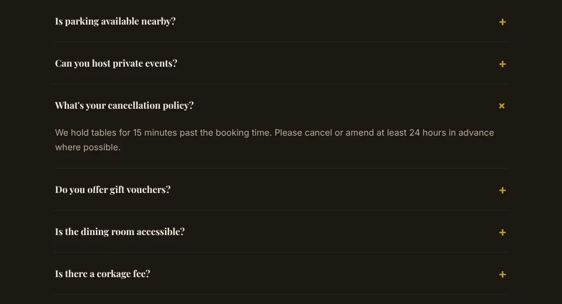
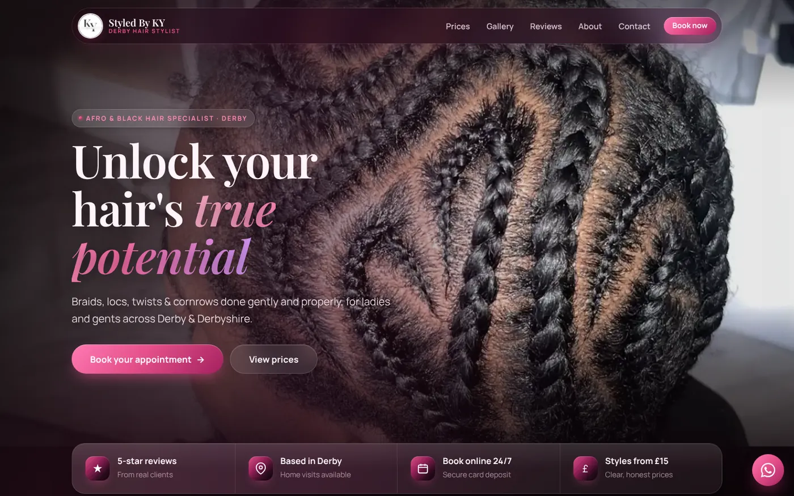

You blocked out three hours on Saturday for a full set of braids. You turned two people away for that slot. At 10:15 you're standing in a tidy room with the kettle on, and the client has read your "on my way?" message and gone quiet.

That's a no-show, and it's the most expensive cup of tea you'll make all week. A small deposit taken at the time of booking is the simplest fix we know. Here's how to set one up without looking grabby or getting the rules wrong.

## A no-show costs more than the appointment

When someone doesn't turn up, you don't just lose their money. You lose the slot, and nobody is queuing to buy a 2pm Tuesday slot at 1:55pm.

You also lose the customers you said no to, who went somewhere else and might stay there.

A deposit doesn't make no-shows impossible. It changes the maths. Booking stops being free, so the people who book are the people who mean it, and when someone does ghost you, you're not left with nothing.

## Decide which appointments need one

You don't have to ask everyone for money upfront. Take deposits where a no-show really hurts:

- **Long appointments**, like braids, locs, colour, a full valet or a tattoo session, where one empty slot is half a day
- **New customers**, who haven't built up any trust with you yet
- **Your busiest slots**, like Saturdays and evenings, which you could easily have filled twice
- **Anything you buy materials for in advance**, like hair extensions or a specific product

You can probably skip it for quick, cheap appointments and for regulars who've turned up every month for two years.

Our Blade and Crown barber concept (a demo, not a real shop) skips the deposit on purpose: pay in the shop after your cut, free cancellation up to 2 hours before. Fine for a 30-minute cut. Terrible for a four-hour braiding session.

## Pick an amount that feels fair

There's no magic number. The deposit needs to be big enough that people take the booking seriously, and small enough that it doesn't put them off booking at all. Two things help:

- **Use a flat amount** rather than a percentage. "£15 deposit" is easier to read than "20% of the total", especially when prices vary by length or size.
- **Take it off the final price.** A deposit that's part of the price feels like paying early. A deposit on top feels like a booking fee, and customers notice.

On the legal side, UK consumer law expects the terms in your contract with customers to be fair. In its advice to wedding venues, the [Competition and Markets Authority](https://www.gov.uk/government/news/wedding-venues-advised-to-play-fair) said terms are more likely to be fair when a deposit is just to reserve the service and is no more than a small percentage of the total price, and when cancellation charges cover the losses you're likely to have because of the cancellation. We're web designers, not solicitors, so if you're planning big upfront payments, get proper advice.

## Write your rules in one breath

A deposit only works if the rules are clear before anyone pays. If you can't read your policy out loud in about 20 seconds, it's too long. Cover these points:

1. How much the deposit is, and whether it comes off the final price.
2. How much notice you need to cancel or move an appointment.
3. What happens to the deposit if they cancel late or don't turn up.
4. How late someone can be before you have to cancel the slot.
5. What happens if **you** have to cancel. (The answer should be: they get a new time or their money back. Fair works both ways.)

Then use the same wording on your website, booking confirmation and Instagram highlights.

## Put the rules right next to the button

The cover picture at the top of this post shows where the rule belongs: directly under the "Confirm Booking" button, in normal-sized text. Not on a separate terms page, not in a pop-up, not in grey on grey.

People are fine with deposits. What they hate is discovering the rule after they've already lost money. Showing it at the moment they commit is the honest way to do it, and it saves you the argument later.

## Three ways to actually take the money

**1. Send a payment link by hand.** Most card payment providers let you create a link and send it in a DM. Cheap to start, but you're still doing it one message at a time and matching payments to bookings yourself.

**2. Use a ready-made booking app.** Lots of booking platforms can take a deposit when someone books. Quick to set up, but check the fees and the contract, because they vary a lot.

**3. Build deposits into your own website.** The customer picks a service and a time and pays by card in the same flow, on your site, in your branding. It's a bigger build, because it has to be tested with real payments before it goes live.

Every card payment provider takes a small fee per transaction. Check the current rates and build them into your prices rather than adding a surprise charge at checkout.

## Reminders do half the work

A lot of no-shows aren't rude, they're forgetful. Someone booked three weeks ago at midnight and life happened.

Send a confirmation straight after booking and a reminder the day before, with the date, time, address, your cancellation rule and a way to rearrange. Someone who can move their appointment in two taps will usually do that instead of vanishing.

## A real example: Styled By KY

:::case Styled By KY | Afro and black hair specialist, Derby
**The problem:** Deborah's clients used to book by DM, and "How do I pay the deposit?" was one of the questions she answered all day while trying to do hair.

**What we built:** a four-step booking flow on her own website. Pick a style, pick a time, add your details, pay a deposit by card. It works on a phone in about two minutes, any time of day, and the deposit comes off the final price. Her terms page spells out the cancellation and lateness rules in plain English.

The site is new, so we have no no-show figures yet, and we won't invent any. The full story is in our [case study on OTR Detailing and Styled By KY](case-studies-otr-detailing-styled-by-ky.html).
:::

## Do this today

1. **Count last month's no-shows** and late cancellations, and write down what each one cost you in lost work.
2. **Pick the appointments that need a deposit.** Start with your longest ones and your new customers.
3. **Choose a flat deposit amount** that comes off the final price.
4. **Write your rules in five short lines**, using the list above.
5. **Put those rules everywhere**: website, Instagram highlight, booking confirmation.
6. **Try a payment link for two weeks** before paying for anything bigger, to see how your customers react.

If you're still deciding whether online booking is right for you at all, our post on [whether you need a booking system on your website](booking-system-for-small-business-website.html) covers that first. If you'd like it built into a proper site, our [website packages and prices](../services.html) are all on the page, or you can get a [free website audit](../free-website-audit.html) and we'll tell you what we'd change.

## FAQ

### Can I charge a deposit for appointments in the UK?

Yes. Plenty of salons, barbers, detailers and clinics do. Make the amount and the rules clear before the customer pays, and keep the terms fair, because UK consumer law expects that.

### How much deposit should I take for a hair appointment?

There's no fixed rule. A flat amount that's a small part of the total price and comes off the final bill is the easiest for customers to understand.

### Can I keep a deposit if a customer cancels?

It depends on the rules you gave them before they paid, and whether those rules are fair. Keeping a deposit for a no-show or a very late cancellation is common. If you're unsure about your situation, get advice from a solicitor.

### Do deposits really stop no-shows?

They make no-shows less likely, because booking stops being free, and they mean you're not left with nothing when someone doesn't turn up. Pair a deposit with a reminder the day before for the best effect.
