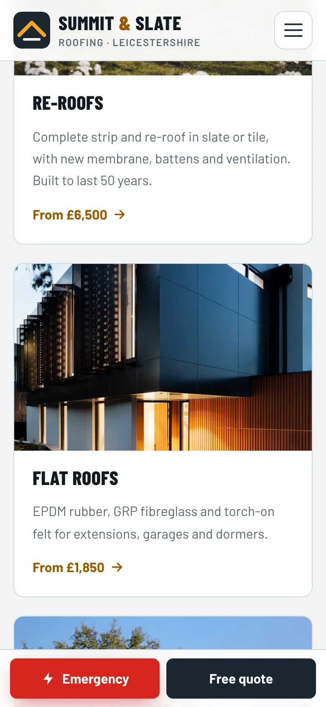
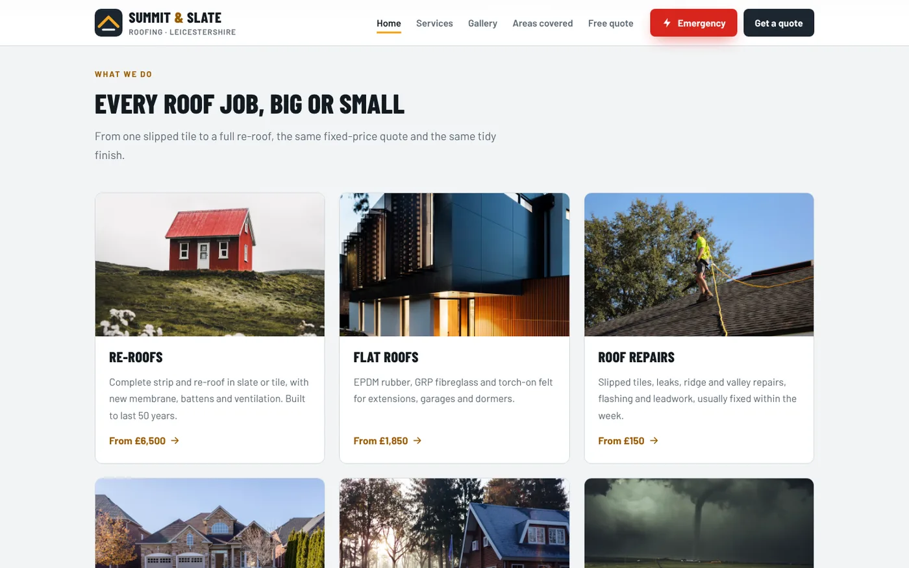
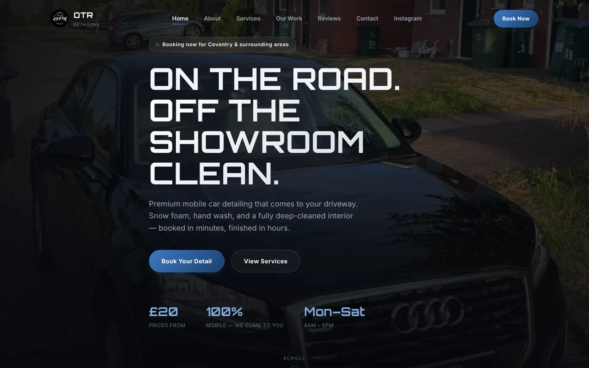

It's half nine on a wet Tuesday night and someone in Hinckley has water coming through the bedroom ceiling. They search "roofer near me", tap the first three results, and give each homepage about as long as it takes to find a bucket.

One of those three gets the call. It usually isn't the best roofer. It's the one whose homepage answered their questions fastest.

This is the checklist we use when we build a homepage for a tradesperson, from the top of the screen to the footer.

## A trade homepage has one job

A homepage isn't a brochure. Its job is to get the right person to call or ask for a quote, and to do that it has to answer four questions:

1. What do you do?
2. Do you cover my area?
3. Roughly what will it cost?
4. Can I trust you in my house?

Everything below answers one of those. If something on your homepage doesn't, it's taking up space.

## The top of the screen says what, where and how to reach you

The first screen someone sees, before they scroll, is the most valuable bit of space you own. On a phone that's a headline, a sentence and a button or two.

- **A headline that says what you do.** "Roofs done right. Leaks fixed fast." beats "Welcome to our website" by a country mile.
- **The area you cover, in words.** "Repairs, re-roofs and flat roofs across Leicestershire" tells a local they're in the right place, and gives Google a clue too.
- **One main button.** "Free quote", "Book a visit" or "Call now". If you do emergency work, an emergency button can sit beside it.
- **A phone number you can tap.** On a phone, a number someone has to copy and paste is a number they won't ring.
- **A few short proof points.** Things like "Fixed quotes" or "Free photo surveys", as long as they're true for you.

That's the layout on the cover of this post: our Summit and Slate Roofing concept site (a demo we built, not a real roofer). In under ten words you know what they do, and the two buttons cover both the panicking customer and the planner.

## Keep the call button under their thumb

Most trade sites forget this bit. The buttons at the top vanish the moment someone scrolls down, and scrolling back up with wet hands is a lot to ask. The fix is a bar of buttons stuck to the bottom of the screen on phones.

On the Summit and Slate concept, the Emergency and Free quote buttons follow you all the way down on mobile, so the customer is never more than one tap from you.

## List your main services, each with a starting price

Next, your main services. Not all 27 things you can do, just the five or six that bring in most of your work. Then the part that makes tradespeople nervous: a starting price on each one.

A "from" price doesn't lock you into a quote. It tells a homeowner they're in the right ballpark before they ring, so nobody is shocked when your quote lands. If you need more convincing, we've written a whole post on why ["DM for price" costs you customers](dm-for-price.html).

## Prove you're real with photos, reviews and credentials

People are letting you into their home, so the homepage needs to show there's a real, competent person behind it, not a stock photo of a hard hat.

- **Your own photos of real jobs.** A small grid of recent work, each labelled with the job and the town, does more than any paragraph. Our guide to [taking photos of your work on a phone](how-to-take-photos-of-your-work.html) covers how to get good ones.
- **Real reviews, with a first name and a town.** Three or four short ones on the homepage, with a link to the rest or to your Google reviews.
- **Your accreditations, if you have them.** If you're Gas Safe registered, NICEIC approved or in a trade association, say so near the top. If you aren't, don't hint that you are.
- **Insurance and guarantees,** but only the ones you actually offer.

On the concept, every review carries a "Sample review" tag, because it's a demo. On a real business site, the only reviews that belong there are ones real customers actually wrote. This isn't just good manners: since April 2025, the Digital Markets, Competition and Consumers Act 2024 has banned businesses from posting or paying for fake reviews in the UK.

## Tell them what happens after they call

A short "how it works" section takes the fear out of ringing a stranger. Something like: send us a photo, get a fixed quote, we book you in, we tidy up after.

Only write steps you actually follow. If you don't do fixed quotes, don't promise them, because the customer will remember that line when your invoice arrives.

## Put the boring bits in the footer

The bottom of the page is where people go once they've decided and just want the details. Make sure it has:

- Your phone number and email, again
- Your opening hours, and whether you answer out of hours
- The towns or postcodes you cover
- A link to your privacy policy
- If you're a limited company, your registered company name, company number and registered office address (the law says your website has to show these, and the footer is the usual home for them)

## What to leave off your homepage

- **"Welcome to our website."** They know. They're on it.
- **The full history of the business.** Two lines on who you are is great. The story of your grandad's first van can live on the About page.
- **Sliders that change every few seconds.** Nobody has ever read slide four.
- **Numbers you can't back up.** "Thousands of happy customers" invites the question "says who?". Only use figures you could prove if someone asked.

## A real example: OTR Detailing

A mobile valeter isn't a hard-hat trade, but the problem is the same: a customer on their phone, deciding who to let onto the drive.

:::case OTR Detailing | Mobile car valeting, Coventry
**The business:** Gideon runs OTR Detailing on his own, driving to customers' homes around Coventry, Monday to Saturday.

**The homepage:** it tells you what he does, where he works and his starting price in about four seconds. His price list has three clear options (£20 exterior, £30 interior, £40 full), and the photos are his own work on real customers' cars.

**Why it's built like that:** most people looking for a valet want three answers: how much, do you come to me, and are you any good. The homepage answers all three before you scroll, which is most of this checklist on one screen.

It's a recent build, so we don't have results figures yet and we won't pretend otherwise. The full story is in our [OTR Detailing and Styled By KY case study](case-studies-otr-detailing-styled-by-ky.html).
:::

## Do this today: the five-minute homepage test

Grab your phone, turn off the wifi so you see what customers see, open your own website and check:

1. Can you tell what you do and where, without scrolling?
2. Can you ring yourself with one tap?
3. Is there a price, or at least a "from" price, for your main services?
4. Are the photos your own work?
5. Are the reviews real, with names and towns?
6. Halfway down the page, how many taps does it take to call you?
7. Is your phone number in the footer?

Any "no" is your first job. If you'd rather someone else took a look, our [free website audit](../free-website-audit.html) goes through exactly this list. And if you're starting from scratch, our [websites for electricians](../websites-for-electricians.html) page shows how we put a trade homepage together.

## FAQ

### What should be on the homepage of a trade website?

What you do and where, a clear button to call or get a quote, your main services with starting prices, photos of your own work, genuine reviews and any accreditations you hold.

### Should a tradesperson put prices on their website?

Starting prices, yes. A "from" price for each main service lets customers check you're in their budget before they call, without tying you to a figure before you've seen the job.

### How many pages does a tradesperson's website need?

Plenty of trades do well with a homepage, a services page and a contact or quote page. Our Standard package covers exactly those for £600, paid once. A strong homepage matters more than a large number of pages.

### Do I need a privacy policy on my trade website?

If your site has a contact or quote form, it collects personal data, so under UK GDPR you need to tell people how you use it. A privacy policy linked in your footer does that job.
