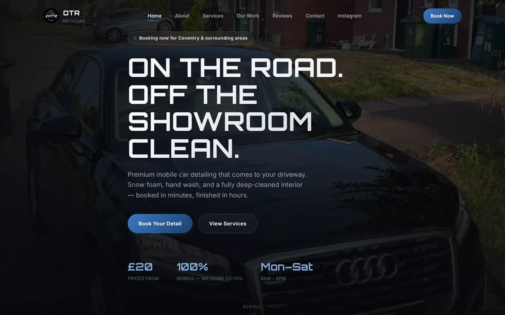
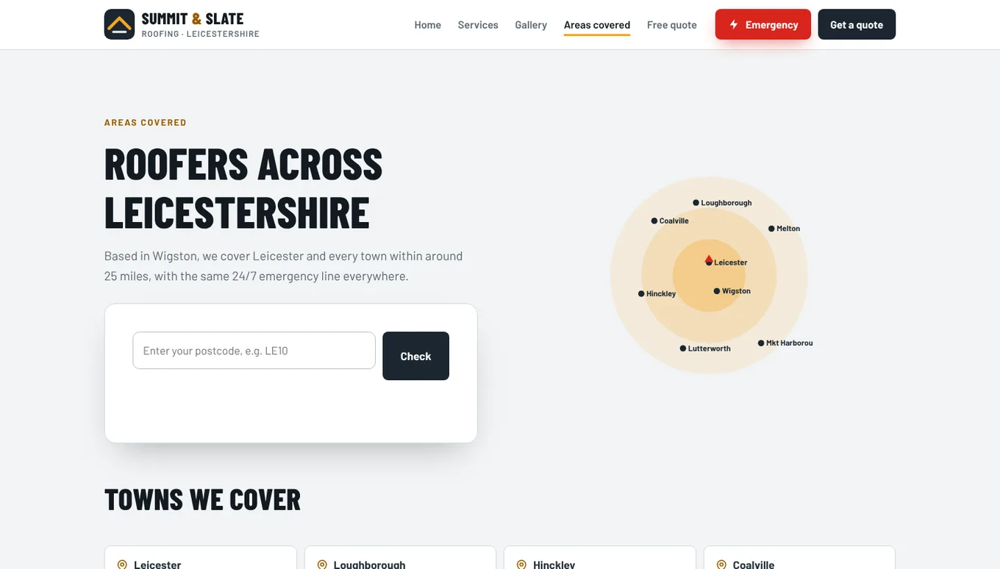
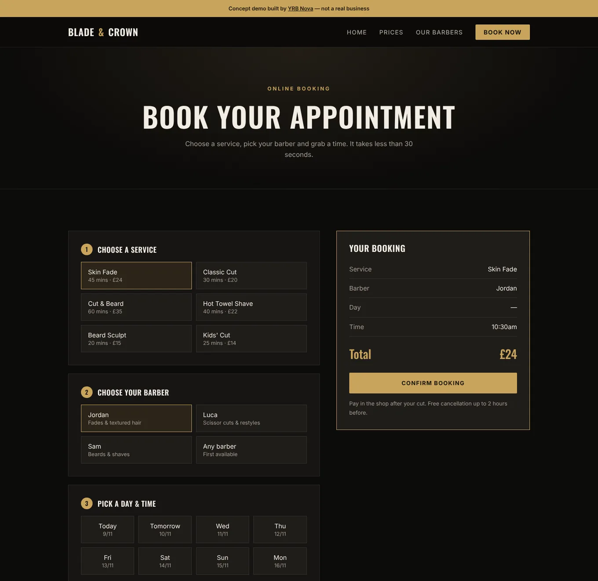

Your Instagram is doing well. The photos look great, people like the posts, and most of your work comes from there already. Then someone you've never met asks "do you have a website?" and you're not sure whether to feel guilty or just send them your handle.

This isn't one of those posts that says Instagram is pointless. It isn't. It's a look at what each one is actually good at, so you can decide where your time and money should go.

## Instagram is your shop window

Instagram is brilliant at one thing: showing people your work and keeping you in their heads.

For anything visual (hair, nails, barbering, valeting, cakes, kitchens, tattoos) it's hard to beat. A before-and-after of a filthy car interior does more selling than a paragraph ever could. And it's free to start, which matters when you're new.

It's also where your existing customers already hang out. They see your post between their mate's holiday photos and think "I should book in". That's real value, and nobody should tell you to stop.

## A website is your till and your front desk

Where Instagram struggles is everything that happens after someone thinks "I want that".

Think about what a new customer needs before they book:

- How much is it?
- Do you cover my area, or where are you?
- When can you fit me in?
- Are you any good, according to people who aren't you?
- How do I pay, and is there a deposit?

On Instagram, most of those answers are scattered across highlights, old captions and your DMs. The customer has to dig, or ask. And asking is where people drop off, especially at 11pm when they're half asleep and you're fully asleep.

A website puts those answers in one place, in order, and ends with a button. It's not more glamorous than Instagram. It's more useful at the moment of decision.

## Where each one falls down

Being fair to both:

**Instagram's weak spots**

- **You don't own it.** Your account runs on Meta's rules. Accounts can be hacked or suspended, and getting one back can take a long time. Your followers don't come with you if that happens.
- **It's hard to search by need.** Someone typing "mobile valeting Coventry" into Google is usually shown Google Maps listings and websites first, not your grid.
- **Old posts sink.** Your best work from March is buried under this week's posts unless someone scrolls for ages.
- **Booking means messaging.** Every enquiry becomes a conversation you have to answer by hand.

**A website's weak spots**

- **Nobody stumbles on it by accident** the way they stumble on a Reel. It needs Google, your Instagram bio and word of mouth to send people its way.
- **It costs money upfront.** Ours start at £350 one-off for a one-page site, and there's optional hosting and support at £10 a month if you want us to look after it. Not a fortune, but not free either.
- **A bad one is worse than none.** A slow, out-of-date site with a 2019 price list puts people off.

## A real example: two Instagram-first businesses

:::case Styled By KY and OTR Detailing | Both ran on Instagram before they had a website
**Before:** Deborah (Styled By KY, afro hair stylist in Derby) and Gideon (OTR Detailing, mobile valeting in Coventry) both had their best work on Instagram. If you wanted a price, a time or a deposit link, you messaged them and waited.

**What we built:** a website that takes over the part Instagram is bad at, while Instagram carries on showing off the work. Deborah's site has a full price list broken down by length and a four-step booking flow that takes a card deposit. Gideon's has three clear packages (£20 exterior, £30 interior, £40 full) with everything included spelled out.

**The pattern worth copying:** Instagram shows the work, and the link in your bio sends people to a page that answers the questions and takes the booking.

Both sites are recent, so we don't have booking numbers to share yet, and we won't make any up. The full story is in our [case study on OTR Detailing and Styled By KY](case-studies-otr-detailing-styled-by-ky.html).
:::

## What a website can do that a grid can't

Here are two things that are awkward or impossible on Instagram, shown on our concept sites. These are demo sites we built to show what's possible, not real businesses.

**An "areas we cover" page.** On our Summit and Slate roofing concept, a customer types their postcode and gets an answer straight away, with a list of towns underneath. A page like this also gives Google something to match when someone searches for a roofer in one of those towns. A pinned post can't really do that job.

**Booking without a conversation.** On our Blade and Crown barber concept, you pick a service, a barber and a time, and the total shows on the right before you confirm. The customer books at midnight and the barber finds a full diary in the morning, rather than a pile of DMs.

## When Instagram on its own is fine (for now)

Plenty of businesses can get by without a website for a while. You probably don't need one yet if:

- You're fully booked from regulars and word of mouth.
- You take very few new customers and you like it that way.
- You're testing an idea and don't know if it'll still exist in six months.
- You genuinely enjoy answering every enquiry personally and have the time.

If that's you, save your money. Put the effort into a clear bio, pinned prices and a filled-in Google Business Profile instead.

## Signs you've outgrown Instagram

On the other hand, it's probably time for a website if:

- You answer the same "how much?" and "are you free?" messages every day.
- People ask for your website, or ask if you're a real business.
- You lose bookings because you couldn't reply fast enough.
- You want to show up when people search Google for what you do near them.
- You want to take deposits so no-shows stop costing you money.

Even one of these is worth taking seriously. Three or more and Instagram is quietly costing you work. We wrote more about that in [why "DM for price" is costing you customers](dm-for-price.html).

## Do this today, whichever way you go

1. **Put your prices in your bio or a pinned post.** Even "from £25" saves a pile of messages.
2. **Make a highlight called "Info"** with your area, opening times, how to book and your cancellation rules.
3. **Set up your Google Business Profile** if you haven't. It's free and it's what shows on Google Maps.
4. **Save your best photos somewhere other than Instagram.** A folder on your phone or cloud storage, so they're safe if anything happens to your account. They're also your future website gallery.
5. **Check your link in bio actually goes somewhere useful.** A booking page or a price list beats a link to your own Instagram (yes, we've seen it).

If you're weighing it up, our [websites for barbers](../websites-for-barbers.html) page shows what we'd build for a typical appointment business, or you can get a [free website audit](../free-website-audit.html) and we'll look at your Instagram as it stands.

## FAQ

### Do I need a website if I have Instagram?

Not always. If you're fully booked from regulars and word of mouth, Instagram can be enough for now. If you spend a lot of time answering price and availability questions, or want to be found on Google, a simple website can save you hours of messaging.

### Is Instagram enough for a small business?

It can be for showing your work and staying in touch with existing customers. It's weaker at answering practical questions, taking bookings and deposits, and getting found by people searching Google for a service near them.

### Can my Instagram link to my website?

Yes. Putting your website in your bio is the most common way to connect the two. Send people from your posts to a page that shows prices and lets them book, so they don't have to message you first.

### How much does a basic small business website cost in the UK?

Prices vary a lot between designers. Our websites start at £350 one-off for a one-page site, with optional hosting and support at £10 a month, and all our [prices are on the services page](../services.html).
