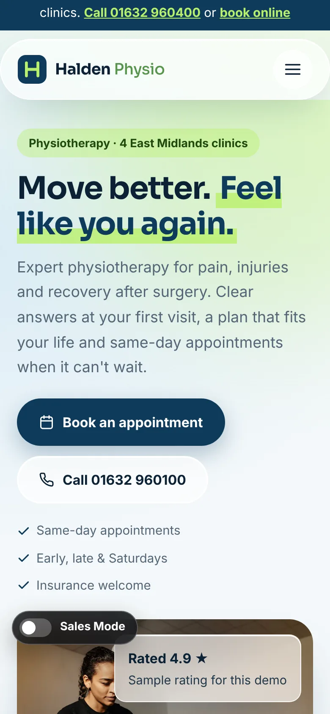
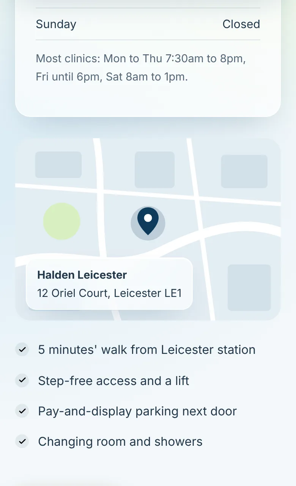
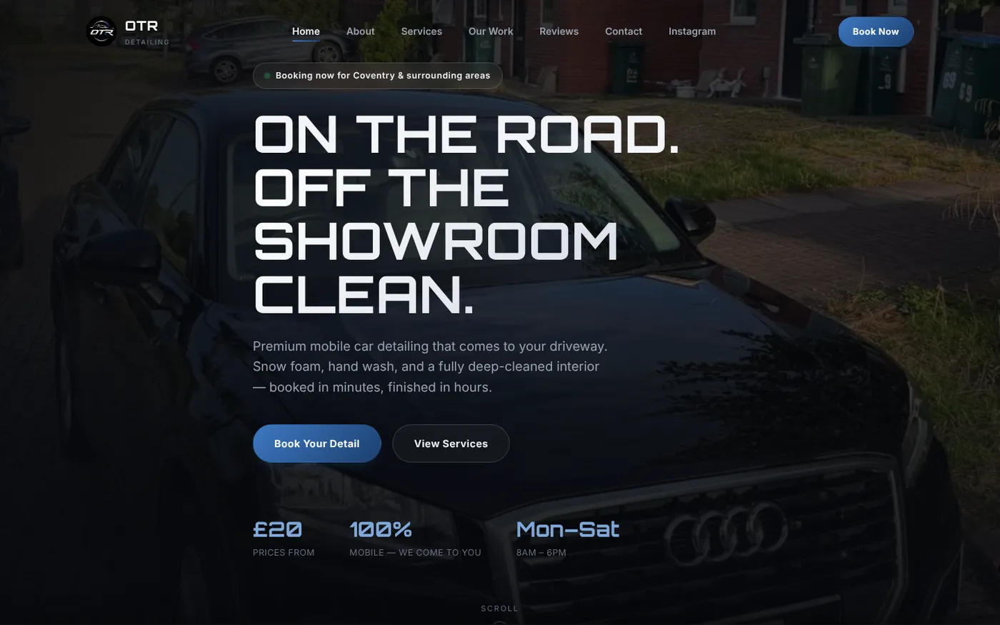

A customer's car has broken down on a B road, they've got one bar of signal and they've just tapped your website on Google. The screen stays white. Then a slider starts loading, one blurry slice at a time.

They don't wait for slide two. They hit back and ring the next garage.

Your site probably looks fine on your laptop at home. Here are the five usual reasons it drags on phones, how to test it for free, and what to sort first.

## Test it the way your customers see it

Start with the free tool Google gives everyone: [PageSpeed Insights](https://pagespeed.web.dev/). Paste in your web address, pick the Mobile tab, and look at the section headed Core Web Vitals.

Google publishes what "good" looks like on [web.dev](https://web.dev/articles/vitals). In plain English:

- **Largest Contentful Paint (LCP):** the main thing on the screen should appear within 2.5 seconds.
- **Interaction to Next Paint (INP):** when someone taps a button, the page should respond within 200 milliseconds.
- **Cumulative Layout Shift (CLS):** under 0.1, which means the page shouldn't jump about while it loads.

Then do the low-tech test. Turn wifi off, stand in your kitchen on mobile data, and open your own site. If you get bored waiting, so will everyone else.

## Culprit 1: photos straight off your phone

This is the big one. A photo from a modern phone is usually a few megabytes and thousands of pixels wide. Your website shows it in a box the width of a phone screen. Every visitor still downloads the whole thing.

Ten of those in a gallery and you've asked someone on a weak signal to download a small film before they see your prices.

The fix is boring and it works:

- **Resize before you upload.** Most website photos don't need to be wider than about 1,600 pixels, and gallery thumbnails need far less.
- **Use WebP.** It's usually much smaller than a JPEG at the same quality, and every current phone browser shows it.
- **Lazy load anything below the fold.** That means photos further down the page only load when someone scrolls near them.
- **Give every image a width and height** in the code, so the page saves a space for it and doesn't jump when it arrives.

If you're about to take a fresh batch of work photos, our guide to [taking photos of your work that sell](how-to-take-photos-of-your-work.html) covers the shooting side.

## Culprit 2: video backgrounds and sliders

A full-screen video behind your headline looks lovely in the designer's office. On a phone it's often the heaviest thing on the page, and it's sitting right at the top where it slows down the first thing people see.

Sliders are the same: several big images loaded to show one at a time.

Swap them for one good photo and a clear headline. If you love your video, move it down the page behind a play button.

## Culprit 3: embeds and widgets nobody asked for

Each bit of someone else's code on your page is another trip to another server. The usual suspects:

- an embedded Google Map on every page
- an Instagram feed widget
- a live chat bubble
- a review carousel pulled in from another site
- a booking widget loaded on pages that don't need it

Stack five and your homepage is waiting on five other companies before it's done.

On our own site, Google Maps and the Cal.com booking widget only load once a visitor has said yes in the cookie banner. That keeps the first load light, and it's tidier for privacy too.

## Culprit 4: page builders, plugins and too many fonts

Drag-and-drop builders and plugin-heavy WordPress sites can load code for features you never switched on, often on every page.

Fonts creep up too. Two typefaces in four weights each is eight files before a word appears. Pick one or two fonts and only the weights you use.

Every so often, switch off what isn't earning its keep. Think of it as clearing the van of things you haven't used since 2021.

## Culprit 5: hosting that's doing too much, or too little

If the server is slow to respond, nothing else matters. Overcrowded shared hosting, no caching and a server on the other side of the world all add delay before your page even starts loading.

You don't need anything fancy. You need a host that serves pages quickly and caches them, so it isn't rebuilding your homepage from scratch for every visitor.

## What a light page looks like: our Halden Physio concept

Halden Physio is a **concept site** we built to show what a multi-clinic practice website could look like. It isn't a real business. It does show most of the fixes above in one place, so here's what's going on under the bonnet.

- **The words come first.** On a phone, the headline, booking button and phone number sit above the photo, so the useful stuff is on screen straight away.
- **The hero photo is asked for first.** It's marked as high priority in the code, so the browser fetches it ahead of anything else.
- **Everything below is lazy loaded.** The treatment and team photos only load as you scroll towards them, and each one has a width and height set so nothing jumps.
- **Images are requested at the size they're shown.** The treatment cards ask for 640-pixel-wide versions, not the full-size originals.
- **One font request, one deferred script.** The main script waits until the page is readable before it runs.

The photos are placeholders, because a fictional clinic has no real ones. On a real build they'd be the owner's own, prepared the same way.

The location pages are the trick worth stealing. Instead of an embedded Google Map, the map is a simple drawing built into the page. It shows people roughly where the clinic is, and the written address and access notes underneath do the rest. On a real site we'd add a plain "Get directions" link that opens the phone's own maps app.

## A real example: photo-heavy sites need this most

:::case OTR Detailing | Mobile car valeting and detailing, Coventry
**The business:** Gideon runs OTR Detailing on his own and drives to customers' houses around Coventry.

**What we built:** a site with his three packages and prices (£20 exterior, £30 interior, £40 full) up front, and a "Recent work" gallery made from his own photos of real customers' cars.

**Why it's relevant here:** detailers, barbers, stylists and builders sell with photos, so their sites are exactly the ones that slow down when nobody looks at image sizes. The site is new, so we have no speed or booking figures to share, and we won't invent any. The full story is in our [case study on OTR Detailing and Styled By KY](case-studies-otr-detailing-styled-by-ky.html).
:::

## Do this today

1. **Run your homepage through PageSpeed Insights** on the Mobile tab and screenshot the result, so you've got a before.
2. **Open your site on mobile data,** not wifi, and time how long it takes to see your phone number.
3. **Check your biggest photos.** Anything over about 500KB is worth resizing and saving as WebP.
4. **Kill the slider or the video background** at the top of your homepage, or move it further down.
5. **List every widget on your homepage** and remove any you can't explain the point of.
6. **Make sure your prices and phone number are real text,** not part of an image.

If you'd rather someone else did the digging, get a [free website audit](../free-website-audit.html) and we'll test your site on a phone and tell you what we'd fix first. If it turns out a rebuild makes more sense, our [websites are fixed prices](../services.html) from £350.

## FAQ

### Why is my website slow on mobile but fast on desktop?

Your laptop is usually on fast wifi with a powerful processor, while phones are often on patchy mobile data. Large images, videos and third-party widgets hurt far more on a phone, so a site can feel fine at home and crawl in a car park.

### How do I check my website speed for free?

Use Google's PageSpeed Insights at pagespeed.web.dev and look at the Mobile results. Then open your site on your own phone with wifi switched off, which is closer to how customers find you.

### Does website speed affect Google rankings?

Google says Core Web Vitals are one of the signals it uses, though relevant content still matters more. The bigger cost is people giving up and going back to the search results.

### What size should images be on a website?

It depends on where they're shown, but most full-width photos don't need to be wider than about 1,600 pixels, and thumbnails need much less. Save them as WebP and keep most under a few hundred KB.
